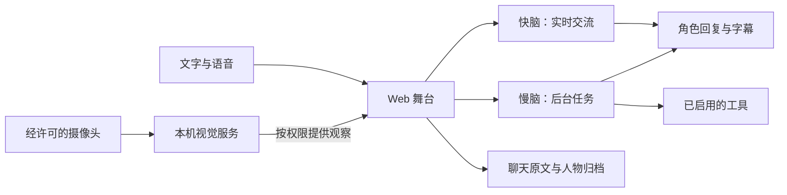

# 数字生命 · AIRI

**一个以角色、实时对话和可管理的记忆为核心的 AI 伙伴项目。**

数字生命基于 [Project AIRI](https://github.com/moeru-ai/airi) 开发，主要面向可在自己电脑上运行的 Web 舞台。你可以用文字或语音和角色交流，也可以按需开启本地视觉，让它根据当前情境问候、接话，或找回你们以前聊过的内容。

我们想探索的是：当 AI 从一次性的问答走进日常相处，它怎样才能跟得上谈话、记得有边界，也知道什么时候该安静？欢迎一起做实验、修问题、补文档，让这些想法在实际使用中经得起检验。

## 设计理念

- **对话继续，任务在后台做。** 快脑负责实时交流，慢脑负责查资料、整理和执行已授权的工具。慢脑工作时可以继续说话；结果准备好后，再找合适的时机交付。
- **感知为互动服务。** 经许可的本地视觉可以为问候、目光和当前对话提供线索。人物识别可帮助归档消息，不替用户登录，也不切走当前聊天。
- **记忆要看得见、管得住。** 聊天原文与人物档案分开保存。可以回看和整理原文，也可以按实际权限删除记录。身份不明确时，不把消息归到上一位来访者名下。
- **用户掌握开关。** 可以暂停主动交流、关闭采集或让舞台休眠。休眠后仍可打开设置和聊天档案。默认可用「陌生人」身份进入舞台，模型服务和设备按需配置。

## 功能模块

| 模块 | 当前能力 |
| --- | --- |
| [角色舞台与聊天](wiki/modules/clients.md) | 使用 Live2D 或 VRM 角色进行文字交流。聊天支持实时字幕、字号和气泡调节，默认跟随新消息，手动上翻时保留阅读位置。 |
| [实时语音](wiki/modules/voice.md) | 已接入豆包实时语音，支持说话、听答、打断、转写和口型联动。需要配置相应服务。 |
| [快脑与慢脑](wiki/modules/fast-slow-brain.md) | 快脑负责实时交流，慢脑处理耗时任务。工作规则可以编辑；有可用的模型和搜索工具时，可执行搜索并返回来源。 |
| [本地视觉与主动交流](wiki/flows/visual-social.md) | 通过本机视觉服务处理摄像头画面，为角色注视、问候和人物归档提供线索。姓名由本人确认，主动交流可以关闭。 |
| [聊天档案与记忆](wiki/modules/chat-archive.md) | 按人物和角色翻阅原文，支持搜索、筛选、收藏、整理和导出。人物档案另有维护入口，受本机开发者权限保护。 |
| [配置同步](wiki/modules/shared-config.md) | 连接同一 Windows 宿主的 Web 客户端可以共享部分模型配置、提示词和会话偏好。设备权限、登录身份和完整聊天档案不随这项功能同步。 |
| [启动、关闭与休眠](wiki/modules/stage-runtime.md) | 舞台启动时分项检查配置和服务；关闭时结束当前生成、通话和采集，保留设置和历史入口。 |

## 数据如何流动



持续视觉的画面交给本机视觉服务处理；主动发送图像给所选模型使用独立权限。聊天原文主要保存在浏览器，人物档案和有限的近期交流记忆保存在本机视觉宿主。调用外部模型、语音或搜索服务时，相应请求会发往你配置的服务。

## 在本地试用

目前优先验证 **Windows 上的 Web 开发环境**。准备 Git、Node.js 和 pnpm，工具版本参考 [`.tool-versions`](airi/.tool-versions) 和 [`package.json`](airi/package.json)。克隆仓库后，在仓库根目录运行：

```sh
cd airi
pnpm install --frozen-lockfile
pnpm --filter @proj-airi/stage-web exec vite --host 127.0.0.1 --port 5173 --strictPort
```

打开 `http://127.0.0.1:5173`，以「陌生人」进入舞台。下面按第一次配置的顺序操作。

## 第一次使用：配置快脑和慢脑

| 想先试什么 | 需要准备 |
| --- | --- |
| 文字聊天和后台任务 | DeepSeek API Key，用于慢脑。 |
| 语音聊天 | 火山引擎豆包实时语音 API Key，用于快脑。要让语音也能委托后台任务，再配置慢脑。 |
| 见面问候和角色注视 | 在上述配置之外，安装本地视觉服务并允许摄像头。 |

### 1. 快脑：豆包实时语音 3.0（Seeduplex）

在火山引擎**豆包语音**控制台开通端到端实时语音的**全双工**服务，在「API Key 管理」创建可用于该服务的 Key。普通豆包文本模型的 Key 不能替代它。参见[火山引擎全双工接口文档](https://docs.volcengine.com/docs/doubao-voice/end-to-end-real-time-voice-full-duplex-version?lang=zh)。

打开 **设置 → 机体模块 → 实时对话**（`/settings/modules/realtime-voice`），填写以下内容，再点 **保存配置**：

| 字段 | 第一次怎么填 |
| --- | --- |
| 豆包实时语音 API Key | 填自己的端到端实时语音 Key。 |
| 模型版本 | `1.2.6.1`。产品名中的「3.0」不是这里的值。 |
| 音色 ID | 项目默认 `zh_female_vv_jupiter_bigtts`。如果账户不支持，改用该服务已授权的音色 ID。 |
| 资源 ID | 保留项目默认 `volc.speech.dialog`。 |

这条链路已包含语音输入和语音回复，不需要另配一套语音识别或合成服务。保存成功只代表本机写入；开始通话时才验证实际服务权限。

### 2. 慢脑：DeepSeek

在 [DeepSeek API 平台](https://platform.deepseek.com/) 创建自己的 API Key。进入 **设置 → 服务来源**（`/settings/providers`），添加 **DeepSeek**，填写 Key，Base URL 使用 `https://api.deepseek.com/`，按页面提示保存和验证。

进入 **设置 → 机体模块 → 意识**（`/settings/modules/consciousness`），将服务来源选为 **DeepSeek**，模型选 **`deepseek-flash`**。如果模型列表未加载，可用页面的手动模型输入，填写账户支持的准确 ID。`deepseek-v4-pro` 也是官方模型选项，第一次试用用 Flash 即可。模型可用范围以 [DeepSeek 官方接入指南](https://api-docs.deepseek.com/zh-cn/) 和账户返回的列表为准。

只有慢脑也可以先用文字聊天。需要让聊天框默认走慢脑时，在 **实时对话** 保持「聊天框使用后台任务与共享上下文」开启。想用慢脑查网页，还要到 **设置 → 网络搜索** 启用可用的搜索服务并手动测试；选择 DeepSeek 或开启思考模式都不会自动联网。

### 3. 快慢脑的分工与提示词

第一遍可以保留默认提示词，先让语音和文字各跑通一次。需要调整时，打开 **设置 → 机体模块 → 实时对话 → 快慢脑系统提示词**：

- **快脑工作提示词**：怎样接话、何时把问题交给慢脑、等待时怎样回应。
- **慢脑任务提示词**：怎样理解任务、查证和使用已授权工具；需要怎样组织结论。
- **结果表达、主动问候与续聊**：按需调整回复长短、主动开口的语气与时机。角色身份和说话习惯仍来自当前人物卡。

结束当前通话或文字模式后再点 **保存提示词**。保存的规则用于下一次任务或通话。

## 配置好以后怎么用

1. **启动舞台。** 返回首页，点击 **启动**，看分项自检。模型已选择或网关就绪不等于外部 API 已鉴权。
2. **先做一次简单验证。** 在聊天框发「用一句话介绍你自己」，验证慢脑。若文字模式正在运行，先结束它。再点击 **开始通话**，允许麦克风，打个招呼并听是否有语音回复，验证快脑。不打开摄像头也可以手动通话。
3. **体验主动模式。** 先按[本地视觉指南](开发文档/07-local-vision.md)安装依赖、准备权重并启动视觉服务。在舞台 **启动** 后，把视觉模式切到 **主动模式**（如果已显示主动模式，就保持当前状态），允许摄像头，并按需开启观察、问候或人脸权限。在单人清晰入镜、麦克风可用且实时语音已配置时，主动模式可以发起一次相遇通话。没有自动开始时，先检查视觉就绪、设备权限与通话状态，也可以手动点 **开始通话**。
4. **试一项后台任务。** 通话中说「帮我把刚才说的内容整理成三条」，再继续闲聊。展开舞台的 **快慢脑协作** 面板查看任务进度与结果。如果已开启并测通网络搜索，再试需要网页来源的问题。
5. **随时暂停或结束。** 切到 **被动模式** 可停下主动视觉交流；点 **结束通话** 可断开语音；点 **关闭** 可让舞台休眠。设置和聊天档案仍可打开。

更多配置见[开发指南](开发文档/04-development-guide.md)、[实时对话说明](开发文档/06-realtime-voice.md)和[本地视觉指南](开发文档/07-local-vision.md)。服务按各自账户规则使用，不要在 Issue、日志或截图中展示密钥。

<details>
<summary>全新克隆：安装可选的 Windows 本地视觉服务</summary>

准备 Python，并在仓库根目录打开 PowerShell。现有视觉脚本需要项目内的 pnpm 入口；如果已有该文件，可以跳过准备 pnpm 的步骤。

```powershell
$pnpmVersion = '11.24.0'
$pnpmDir = ".tools/pnpm-$pnpmVersion"
if (-not (Test-Path "$pnpmDir/bin/pnpm.mjs")) {
    New-Item -ItemType Directory -Path $pnpmDir -Force | Out-Null
    npm pack "pnpm@$pnpmVersion" --pack-destination .tools
    if ($LASTEXITCODE -ne 0) { throw '无法下载 pnpm，请检查 npm 配置。' }
    tar -xzf ".tools/pnpm-$pnpmVersion.tgz" -C $pnpmDir --strip-components=1
    if ($LASTEXITCODE -ne 0) { throw '无法解压 pnpm。' }
}
./scripts/vision.ps1 install
./scripts/vision.ps1 prepare
./scripts/vision.ps1 start
```

`prepare` 下载所需模型权重。GPU 加速、模型许可和设备排查见[本地视觉指南](开发文档/07-local-vision.md)。如果只体验文字或手动语音，可以跳过视觉服务。

</details>

仓库保留源码、依赖锁文件和安装说明。运行环境及所需模型权重按需安装，服务密钥与个人数据留在部署端。桌面端和移动端保留上游代码，本项目新增的 Web 宿主能力尚未在各端完整接入和验收。不同设备上的识别质量、实时语音延迟和长时间运行仍需要更多实测。

## 欢迎一起完善

下面的方向适合从一个小问题开始，也欢迎提出新的方案。

| 方向 | 可以从这里开始 |
| --- | --- |
| 新手上手 | 在干净环境走一遍 Web 安装，补充缺失步骤、常见错误和可选模块的检查方法。 |
| 首次加载性能 | 记录首访下载量和舞台可用时间，尝试按需加载角色与大资源，再比较改动前后的数据。 |
| 语音体验 | 复现打断、后台任务重叠或字幕漏记，用生成的输入补一个能稳定重现问题的测试。 |
| 视觉可靠性 | 用合成或经授权的测试素材验证弱光、遮挡和多人交错，记录误认、漏认和恢复时间。 |
| 记忆与隐私 | 补充匿名人物归档、多人隔离、清除与导出的测试；探索可追溯来源的检索与回顾。 |
| 客户端与无障碍 | 改善键盘导航、字幕可读性和窄屏布局，梳理哪些功能可以在桌面端和移动端复用。 |

反馈问题时，欢迎在 [Issues](https://github.com/taoxingyu0519/digital-life/issues) 写明系统、浏览器、复现步骤、预期结果和实际结果。提交 **Pull Request** 时，建议一次解决一个明确问题，并说明你是怎么验证的。代码之外，安装文档、测试用例、翻译和体验反馈都很有价值。

请使用生成或脱敏的示例。不要在 Issue、提交或截图中附上服务密钥、私人对话、人脸照片或人物数据库。

## 源码与致谢

- [`airi/apps/stage-web`](airi/apps/stage-web)：Web 舞台和本机网关入口。
- [`airi/packages/stage-ui`](airi/packages/stage-ui)、[`airi/packages/realtime-voice`](airi/packages/realtime-voice)：交互、会话编排与实时语音。
- [`airi/services/local-vision`](airi/services/local-vision)：视觉推理与人物档案。
- [系统架构](开发文档/01-system-architecture.md) · [开发指南](开发文档/04-development-guide.md)

感谢 [Project AIRI](https://github.com/moeru-ai/airi) 的维护者和贡献者。上游 AIRI 源码采用 [MIT 许可](airi/LICENSE)；字体、角色素材、模型和其他第三方资源请以各自的许可说明为准。
