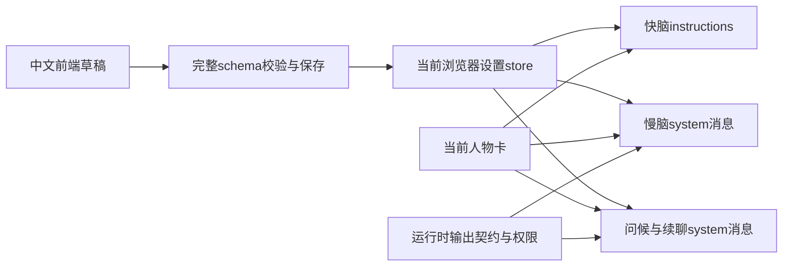

# 快慢脑提示词前端编辑与模型接入

日期：2026-10-08。任务：AIRI-033。状态：已实施。

## 目标与选择

用户要在快慢脑模块亲自查看和修改系统提示词。原规则散落在任务、会话策略和续聊代码中。
新增独立提示词契约与共享设置store，让前端编辑和模型请求读取同一份已保存配置。
默认行为规则整理为中文，保留原职责、事实边界、任务版本和唯一发声路径。
当前人物卡仍提供身份、描述、性格和场景，不在编辑器复制第二份人物档案。

## 设置接口

`@proj-airi/realtime-voice/prompts`提供默认值、完整Valibot schema及后台输出契约。
`useBrainPromptsStore`提供只读config、invalidStored、revision，以及save和reset。
save校验完整快照并原子替换。配置存于当前浏览器域名的localStorage，不上传服务器或跨设备同步。
无效存储会明确提示，并暂用合法默认值。恢复默认先写草稿，再由用户保存。

| 字段 | 实际消费者 | 上限 |
| --- | --- | --- |
| fast | 豆包启动与活动上下文更新 | 2500字符 |
| slow | 后台正式任务系统消息 | 3000字符 |
| result | 慢脑result_summary表达 | 2000字符 |
| continuation | 主动问候与自动续聊的拟稿请求 | 4000字符 |
| core | 快脑非基础风格的共同规则 | 1500字符 |
| styles | 所选风格的快慢脑表达，chatty同时用于续聊 | 每种2000字符 |

基础模式不添加快脑风格。其他风格可分别编辑，切换风格不清除其保存内容。
运行时继续强制任务JSON解析、续聊纯口语输出、工具权限、任务版本与播放确认。
提示词描述行为，不能新增工具、授予权限或改变协议schema。

## 数据与生命周期

UI在活动语音或文字模式期间禁止保存。设置接口发生修改时，实时store结束原通话并清理旧工作。
续聊请求同时捕获提示词revision，迟到稿不能跨保存版本发声。
正式请求仍保持原派发、版本和取消控制。提示词不写入任务记录、日志或云历史。

预览使用实际请求规则的来源，包含当前人物卡、账号上下文及已注册工具提示。
实时会话、视觉、任务资料在发送时另行加入。快脑人物内容仍受16000字符总预算约束。
预览不宣称是包含全部运行时资料的抓包，也不触发模型调用或麦克风。

## 验证边界

真实Vue/Pinia浏览器测试验证编辑、保存、持久化重读、无效草稿、恢复默认和旧稿隔离。
外部模型/音频边界使用替身，检查实际序列化请求中的自定义规则，不声称验证了真实模型遵从度。
实际本机页面已显示中文编辑入口和展开项。真实DeepSeek/豆包效果仍由用户后续会话验收。
命令和结果见[中文报告](../reports/2026-10-08-brain-prompt-editor.md)。
