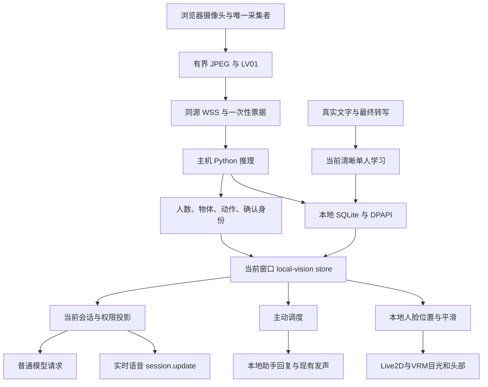

# 视觉社交的数据流和失效条件

2026-10-11，AIRI-037：舞台启停成为采集的共同门控。关闭立即释放各窗口设备并失效旧观察，维护时钟不能重开；启动恢复原主动/被动偏好并清除自动退避。宿主视觉进程只在无绑定和查询时停止，详见[统一启停](../modules/stage-runtime.md)。

核对日期：2026-10-05。范围：本地 Web、Python、管理权限和模型请求之间的数据。关联任务：AIRI-008、AIRI-011、AIRI-025。

原始帧用于本地推理。当前观察是短期文字。人物交流记忆是本地持久数据。
这三种数据在不同边界处理，不能用一个“记忆”字段替代它们。

## 采集和协议

先初始化访客会话，再绑定摄像头。主窗口拥有采集生命周期，其他消费者使用 CameraLease。
采集维护使用独立时钟，麦克风授权和模型回答不阻塞摄像头恢复。
浏览器先 POST 获取一次性票据，再建立同源 WebSocket。LAN HTTPS 使用 WSS。
单帧在途限制避免帧队列无限积累。

LV01 包头绑定 session_binding_id、source_id、epoch、privacy_generation 和帧序号。
TypeScript 与 Python 校验同一边界。乱序、旧代际、超时和超大帧被丢弃。
观察 valid_for_ms 至多两秒。客户端还检查当前会话、拥有者和观察年龄。

## 权限与模型投影

projectObservation 每次请求检查当前权限。人数、物体和动作受观察权限控制。
姓名需要姓名、人脸权限及 confirmed 状态。物体最多八个，基础视觉投影截取至一千二百字符。
人物记忆另有有界投影。引用只表示用户曾这样说，不证明内容真实。

普通聊天在 provider 边界临时加入视觉文字。实时通话通过 session.update 更新同类文字和记忆。
2026-10-06，AIRI-027将注册投影细分为project文字与projectScope授权/相遇范围。帧时间、物体和动作仍更新文字，不改变scope；权限、来源、人物和姓名状态改变scope。续聊请求前后核对范围与观察撤回，普通帧刷新不取消在途稿件。普通聊天的临时投影和历史排除保持原行为，32项聊天契约回归通过。
关闭采集、撤销权限或切换角色后，旧观察立即失效。切换会话取消旧工作并移动当前视觉投影，摄像头保持连续采集。
原始画面不进入上下文注册表、广播同步或历史。
手动“看一下”使用独立图像外发权限和已有视觉 provider。

`face_bbox` 是当前单脸在未镜像画面中的位置，无脸明确返回 null。
人脸位置与已确认身份分开，模糊但可检测的陌生脸也可用于注视。
Web 镜像、平滑和短时保持后通过 Stage.gazePosition 驱动角色，不把坐标注入聊天或保存到记忆。
跟随要求主动模式、采集拥有权、人脸和观察权限。画面年龄连同往返耗时最多 500ms。
来源代际改变、权限撤销、被动与失脸清空目标。头部回到动画，不继续注视旧轨迹。

## 输出与学习

主动输出是助手事件，不伪造用户消息。视觉派生回复保留本地可见性，并排除后续模型历史与云同步。
真实用户文本及最终 ASR 才能更新姓名与交流记忆。多人、模糊归属和旧代际不能写入档案。
姓名进入 confirming/correcting 候选，复述并请本人确认后才允许登记或原人物改名。
social 返回持久行为规则与候选状态，普通请求和实时 session.update 使用同一投影。
候选期间隐藏旧姓名及交流记忆。行为规则来自开发者维护，交流正文仍作为不可信引文。
人物总表与维护接口要求本机开发者 Cookie。自动学习和当前人物回忆保留清晰单人、轨迹、角色和代际检查。
管理修改先撤销观察代际并清空运行状态，防止旧结果恢复被改名或删除的档案。
停止采集后迟到的结果不得复活角色、摄像头或姓名。

## 源码证据

- [local-vision-runtime.vue](../../airi/apps/stage-web/src/components/local-vision-runtime.vue)：运行生命周期。
- [client.ts](../../airi/packages/local-vision/src/client.ts)：LocalVisionCapture 和帧传输。
- [contracts.ts](../../airi/packages/local-vision/src/contracts.ts) 与 [protocol.py](../../airi/services/local-vision/protocol.py)：两端契约。
- [vite.ts](../../airi/packages/local-vision/src/vite.ts)：本机控制网关。
- [local-vision.ts](../../airi/packages/stage-ui/src/stores/local-vision.ts)：窗口状态、权限和投影。
- [local-vision-context.ts](../../airi/packages/stage-ui/src/services/local-vision-context.ts)：当前请求与真实输入接线。
- [policy.ts](../../airi/packages/local-vision/src/policy.ts)：projectObservation。
- [developer.py](../../airi/services/local-vision/developer.py)：独立开发者会话和维护接口。

姓名算法见 [视觉算法](../algorithms/local-vision.md)，持久数据见 [数据与记忆](../modules/storage-memory.md)。
返回 [Wiki 首页](../README.md)。

## 舞台本地账户

2026-10-09，AIRI-034：`local-vision.updateIdentity` 只接受同源代际内的新鲜确认单人。
人脸、姓名和观察权限缺一不可，姓名纠错与多人状态不能登录。
共享 `stage-identity` 只广播姓名、持久人物 ID 和短租期，租期最多两秒。同一人物最多每秒续期一次。
右上角、普通聊天、快脑与慢脑读取同一身份，离开或失效后回到陌生人。
账户切换取消旧回答和音频，重新选择本地会话，不重启摄像头。
主动语音按轨迹与账户共同区分相遇，在已配置宿主内接管新账户通话。
当前是本地人物身份，不授予 hosted 权益或开发者权限。详见[数据与记忆](../modules/storage-memory.md)。

证据：[stage-identity.ts](../../airi/packages/stage-ui/src/stores/stage-identity.ts)、[账户回归](../../airi/packages/stage-ui/src/stores/stage-identity.browser.test.ts)。

2026-10-06，AIRI-028/029：帧的recognition/adaptation仅用于本地诊断。轨迹持续状态不附人物ID/姓名或私人记忆。新增[基础复核与可撤销扩展](../algorithms/face-adaptation.md)。活动话痨首次问候进入同一语音槽位，排空才存一次历史；未捕获上下文的空闲计时不因scope刷新重排。
