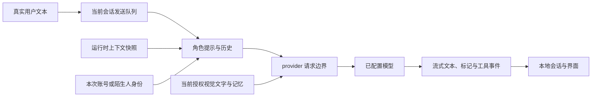

# 对话生成与上下文算法

AIRI-046：主舞台增加实时字幕展示层，字幕按消息ID覆盖同一可见项，保留首次出现时间；进行中不提供删除或回复，不提前进入模型确认事实。已完成的相同短回答可在不同响应中分别保留。详见[语音链路](voice.md)。

AIRI-039：Web 的提示词、慢脑模型和会话偏好改由台式机共享，运行时仍从现有 store 读取已保存值。风格持久契约抽到 conversation-contract 并由原入口重新导出，编排、摘要分段和工具权限不变。未保存草稿单独保护，见[配置同步](shared-config.md)。

2026-10-11，AIRI-037：共享输入在舞台休眠时保留草稿并提示先启动；关闭取消普通发送和实时任务。底层send/retry/工具重跑在改写原文前拒绝休眠执行。历史查询仍可用，启动自检不发送付费模型请求。入口和底层旧契约已纳入固定门禁，见[统一启停](stage-runtime.md)。

核对日期：2026-10-04。范围：普通文本模型、本地文字入口、共享搜索与会话策略。关联任务：AIRI-002、AIRI-011、AIRI-013、AIRI-016、AIRI-018、AIRI-023。

普通对话由 stage-ui 连接界面状态，由 core-agent 编排生成，再由 provider-inference 调用已配置模型。
“意识模块”是模型选择和编排入口。这个名称不证明系统具有意识。

桌面与移动布局的本地文字入口先经use-chat-input。选中慢脑且启用后台文字偏好，或已有实时会话时，纯文字进入同一任务运行时。
纯文字模式不申请麦克风；没有任何模型配置时给出本地化配置提示并保留草稿。
图片仍走普通模型，直接普通chat API与历史重试沿用原编排；不能把入口路由解释为所有聊天API均已改写。
意识模块仍供普通模型聊天，也供[快慢脑](fast-slow-brain.md)的后台模型选择。
文字直接提交慢脑任务，语音要由快脑模型调用spawn_thinking。两入口共用任务执行器；文字成功不能证明语音已派发。AIRI-021将真实慢脑搜索状态投影给快脑，并同步活动通话工具。回归覆盖两轮搜索和播放送达，见[联动报告](../../airi/docs/ai/reports/2026-10-03-voice-slow-brain-link.md)。
AIRI-022改为应用统一安排后台受理语和结果朗读，待播稿不同时交给快脑生成；语音记录按发言ID匹配音频结束且本地排空后保存。文字仍按实际显示确认，路由与工具证据规则不变，见[播报修复](../../airi/docs/ai/reports/2026-10-03-voice-delivery-fix.md)。

AIRI-023将所选会话风格投影到真实快脑启动/更新与后台请求，当前明确要求优先。文字回复和语音采用同一份口语result_summary，避免建议发言改掉数字或条件；分段确认送达，打断需明确继续，见[会话策略改进](../../airi/docs/ai/reports/2026-10-04-fast-conversation-policy.md)。普通模型聊天不额外注入此实时协作策略。

普通模型与慢脑从tool-resolver获得同一web_search，受网络搜索开关和所选服务门控。Firecrawl留空Key走同源宿主的官方CLI匿名搜索，显式Key走账户接口；不自动复用宿主已有凭据。Tavily需要Key。工具系统提示与权限同步，网页摘要保持不可信内容包裹。模型选择是否调用，工具返回实际来源与消耗，配置成功不冒充联网成功。详见[搜索修复报告](../../airi/docs/ai/reports/2026-10-03-firecrawl-403-fix.md)。

AIRI-024增加活泼话痨。文字任务采用所选风格，自动续聊只在活动语音通话执行，由应用事件而非假用户输入触发，复用当前角色和已选慢脑；不新增记忆采集和数据库写入。详见[话痨专题](chatty-conversation.md)。

## 输入到输出

chat.ts 接收发送请求，跨窗口请求由选举出的领导窗口执行。
core-agent 在发送队列中组合会话历史和上下文，处理流式标记、工具事件及生命周期。
切换或清空会话时取消旧会话的待发送工作。工具的显式选择来自当前请求，历史记录不授予权限。

AIRI-045：普通助手回复沿用原输入的归档人物；摄像头主动问候按当前人物捕获，不继承上一用户。没有新增用户输入时，也不会为问候伪造用户消息。

## 上下文注册规则

context-registry 按来源分桶。来源优先取 metadata 中的模块或扩展身份，再取 source，最后用 unknown。
replace-self 替换该来源的活动条目，append-self 追加条目。
注册表用 structuredClone 隔离调用者的后续修改。诊断历史默认保留四百次摄入记录。
四百是诊断条数上限，不是活动上下文的 token 限额。通用旧上下文清理仍有源码 TODO。

角色提示在组合阶段加入。账号身份每次请求重新生成，不写进持久上下文桶。
退出账号后，下次请求恢复陌生人，避免沿用旧姓名。
2026-10-28，AIRI-045：登录身份只来自真实认证。人物归档使用独立的 `archiveUserId`，人脸变化不切换主舞台会话，不取消正在进行的普通生成或音频。AIRI-034 的人脸账户方案已被替代。
普通输入派发时捕获人物 UUID，助手回合沿用同一归属；字段保存在本地原文中，不加入模型指令。已确认姓名仍可通过当前授权视觉投影供模型称呼。
归档回顾按当前人物和角色过滤。旧读取因范围改变而失效时返回空回顾，聊天继续。完整数据路径见[聊天档案](chat-archive.md)。
源码与浏览器验证见[本地账户](../../airi/packages/stage-ui/src/stores/stage-identity.ts)和[账户回归](../../airi/packages/stage-ui/src/stores/stage-identity.browser.test.ts)。
视觉文字在诊断快照之后、实际模型请求之前加入。它有独立权限、代际和有效期检查。
视觉派生的助手回复标记 localVisionDerived，排除后续模型历史和云同步，避免循环强化旧观察。

## 定位与验证

| 修改目标 | 源码证据 | 相关测试 |
| --- | --- | --- |
| 发送接线与视觉投影 | [chat.ts](../../airi/packages/stage-ui/src/stores/chat.ts) | chat.contract.test.ts |
| 豆包文字路由与草稿恢复 | [use-chat-input.ts](../../airi/packages/stage-ui/src/composables/use-chat-input.ts) | realtime-brain.browser.test.ts |
| 队列、组合和流式生成 | [chat-orchestrator-runtime.ts](../../airi/packages/core-agent/src/runtime/chat-orchestrator-runtime.ts) | 同目录同名 test |
| 来源桶与诊断历史 | [context-registry.ts](../../airi/packages/core-agent/src/runtime/context-registry.ts) | 同目录同名 test |
| 陌生人身份 | [user-account.ts](../../airi/packages/stage-ui/src/stores/chat/context-providers/user-account.ts) | user-account.browser.test.ts |
| 服务协议与生成适配 | [generation.ts](../../airi/packages/provider-inference/src/generation.ts) | provider-inference 相关协议测试 |
| 共享联网工具、来源与免费错误 | [web-search.ts](../../airi/packages/stage-ui/src/tools/web-search.ts)、[tool-resolver.ts](../../airi/packages/stage-ui/src/stores/ai/chat-llm/tool-resolver.ts) | firecrawl-search.browser、web-search.browser、tool-resolver.test |
| 搜索403、主机转发、账户Key与注册 | [搜索网关](../../airi/packages/stage-ui/src/tools/web-search-gateway.ts)、[设置模块](../../airi/packages/stage-ui/src/stores/modules/web-search.ts) | web-search-gateway.test、web-search.browser；[修复报告](../../airi/docs/ai/reports/2026-10-03-firecrawl-403-fix.md) |

具体测试命令见 [开发指南](../../开发文档/04-development-guide.md)。
实时语音使用独立端到端模型，见 [语音链路](voice.md)。长期语义记忆边界见 [数据与记忆](storage-memory.md)。
2026-10-06，AIRI-027只调整自动续聊等待、已听阶段及视觉范围验证；不伪造用户轮次。视觉注册提供文字和scope，普通聊天继续使用当前请求文字。沉默反思不进入持久聊天或用户画像。32项聊天契约回归通过，真实模型仍独立验收。

返回 [Wiki 首页](../README.md)。

2026-10-06，AIRI-028/029：实时摄像头问候排空才存一次助手历史，摄像头不预写重复语音记录。recognition/adaptation诊断与未复核轨迹候选不进入模型上下文、个人交流记忆或同步。

2026-10-08，AIRI-033：快慢脑工作提示可在前端修改，但人物卡仍提供共同身份，普通聊天入口与其配置保持原职责。
正式慢脑任务读取已保存slow/result/当前风格及已注册工具提示，强制JSON输出另由程序附加。见[提示词专题](brain-prompts.md)。

AIRI-035：普通模型在实际请求边界加入当前人物与智能体的有界档案回顾，并注册跨会话搜索、原文展开和整理工具。回顾不写进持久上下文桶，页面关闭后仍可读取。换人或换角色拒绝旧 IO，打断与视觉派生内容不用于回顾。详见[聊天档案](chat-archive.md)。
