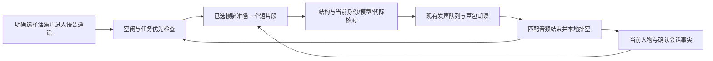

# 活泼话痨与自动续聊

2026-10-11，AIRI-037：舞台休眠结束当前通话、草稿和自动任务，不能由静音倒计时或视觉维护恢复。启动后仍使用保存的风格、等待和预算规则。固定门禁继续执行原暂停、打断、相遇与续聊测试，见[统一启停](stage-runtime.md)。

核对日期：2026-10-06。任务：AIRI-024、AIRI-026、AIRI-027。范围：既有快慢脑的第五种会话风格。

## 表达与人物

高主动、高表达、低回应索取。主动分享具体观点、选择、脑洞和想象的小计划，而不是反复问用户问题。
沿用当前人物卡，不额外创建“小雀”或多人格管理。通过场景和选择展示性格，不重复念自我介绍。
用户不回应也能自然续聊；沉默不代表认可、偏好或负面情绪。用户贡献和纠正改变下一段方向。
模型提示约束空泛夸奖、情绪索取、虚假亲密、编造共享经历和把幻想说成真实查询。
这些表达规则已进入实际请求，但不保证模型每次遵守或每个用户都舒适。

## 单一运行时

安静达到用户配置的时长才准备一段，默认5秒，UI支持1–120秒及5/10秒快捷选择。设置在当前浏览器保存，修改立即重排未开始的计时，生成和播放另需时间。目标80–180字、上限400字符。最多一个计时器或有效草稿，没有预生成长队列。
复用意识模型和core-agent，输入为明确应用事件的system包络，附16条近期确认事实和授权视觉文字。
不伪造user消息，不挂载工具、不执行搜索。不引入协调模型、外部服务、账户或新的用户画像采集。
接收的私有分析不作为稿件；只验证最终口语文本。AIRI-026移除单字段JSON要求，短稿显式关闭深度思考，不更改正式任务设置。候选只在仍有效的空闲时进入同一sendSpeech队列。
实际播放完才记录，打断未播完的内容排除。正式任务执行或待投递时不准备闲聊，用户原生对话仍可继续。
摄像头companion在活动话痨通话中保留授权上下文和原通话生命周期，让出周期性闲聊发声，首次相遇问候进入同一语音队列。

## 无回应反思与换话题

续聊请求收到当前人物、确认事实和continuation_state。没有新用户发言时，首次分享，再给模型最多两段轻试探机会，随后要求换话题并展开。已有真实用户输入时，从该话题的反思机会开始。
模型私下考虑措辞冒犯、话题不合、用户忙碌或正在倾听等可能性，自行选择试探或直接分享。沉默不证明其中任一种，不输出分析或写成长期偏好。
运行时只控制阶段与预算，不按关键词推断心理。仅匹配音频完成且本地排空的自动片段推进阶段；打断或仅生成的不计入。真实新用户转写归零，接住最新内容。
两段是试探机会预算，不代表模型一定问两次；提示遵循与自然听感必须用实际模型验收。

## 观察刷新与授权范围

旧全文比较把observed_at和每帧物体/动作更新视为失效，会取消在途草稿或拒绝完成结果，AIRI-027先复现再修复。
local-vision提供project与projectScope，注册服务向语音及草稿消费者提供文字与稳定范围。scope绑定采集来源、权限、主人物及姓名状态，排除帧时间和动作。
普通刷新不取消草稿或重排等待，新请求读取新观察。撤回观察、权限或相遇范围变化仍取消，并中断相关自动播报。
失效属于取消，不冒充模型服务故障。单纯关闭深度思考或增加超时无法修复观察刷新导致的取消。

## 取消、暂停与预算

用户开口取消旧准备，按后续确认事实重新组织。切换风格、模型、身份、人物、会话、视觉授权变化和挂断使旧候选失效。
UI暂停/继续与模型按用户明确要求调用set_agent_delivery，控制自动闲聊和结果。暂停不取消正式任务。
面板与调度使用同一continuationStatus，显示静音倒计时、正在倾听、等待播放、任务优先、准备或实际错误。播放与活动结果是响应状态，交付后释放阻塞。总上下文优先保留策略和有效事实/任务JSON，再分配人物与视觉，避免16000字符网关拒绝。
手动打断和静音会暂停自动发声，不因下一次静音结束擅自恢复。恢复不重置预算。
每通话最多30次准备请求，中止和失败也计数。显示3/30不等于失败三次。单请求45秒超时，失败后停止自动重试，面板提供重试入口。
原10分钟限制、隐藏/导航停止和不自动重连规则保留。次数用尽仍可正常对话和执行任务。
未选慢脑只应用豆包表达风格并提示配置。纯文字只改变风格，不自动续聊；单选风格不启动麦克风。
上述数字为工程预算，不是心理学阈值，不宣称全天运行。真实用量由所选模型和语音服务计费。

## 错误与人物表达

旧布尔提示无法还原用户那次具体失败原因，不把它猜成断网或JSON错误。
HTTP状态在请求边界保留，服务正文和密钥不进入诊断。区分超时、网络、服务不可用、稿件不合格和其他生成错误。
语音设置提供独立短稿测试，使用当前模型和人物，不开语音、不挂载工具、不使用聊天历史。
同一人物卡进入快慢脑及续聊请求。工具受理和等待稿由快脑拟定，再由运行时安全调度。
人物卡编辑入口在语音设置中可见。提示词引导表达，不能替代取消、去重和播放确认。

## 证据与验收

入口为conversation.ts策略/输出schema、slow-brain.composeContinuation、realtime-voice当前会话调度、companion协调和共用设置/面板。
自动测试覆盖无回应连续两段、确认事实、插话迟到稿、UI/工具暂停、正式任务优先、错误/超时、30次上限、模型切换、视觉撤回及挂断。
测试浏览器未配置真实慢脑；真人听感、真实DeepSeek生成与豆包连续交接、长时稳定性待AIRI-004验收。
最新[等待与反思报告](../../airi/docs/ai/reports/2026-10-06-chatty-idle-and-reflection.md)记录101项相关回归、55类型任务及实际UI持久化。测试浏览器未配置真实慢脑，DeepSeek/豆包与真人链路仍待验。
前次[准备与人设报告](../../airi/docs/ai/reports/2026-10-06-chatty-preparation-and-persona.md)与[历史中文报告](../../airi/docs/ai/reports/2026-10-04-chatty-conversation.md)保留原验证数字。另见[快慢脑专题](fast-slow-brain.md)。

返回[Wiki首页](../README.md)。

2026-10-09，AIRI-034：账户切换与旧通话终止共同撤销续聊草稿和自动音频。新人物接管后使用自己的会话与即时身份，不能沿用上一账户的待播稿。摄像头采集保留，观察继续更新，见[人脸账户记录](../memory/sessions/2026-10-09-face-stage-accounts.md)。

2026-10-06，AIRI-028：视觉scope变化保留未捕获上下文的空闲截止时间，取消捕获过数据的草稿与自动发声。首次摄像头问候使用greeting并进入同一槽位，排空后才存一次，不推进试探。最新修复见[问候报告](../../airi/docs/ai/reports/2026-10-06-active-greeting-and-recognition.md)。

2026-10-08，AIRI-033：chatty风格和continuation规则可在[提示词编辑器](brain-prompts.md)修改。续聊拟稿读取保存内容和当前人物，捕获prompt revision，迟到稿不能跨版本。
默认规则为中文，原30次预算、45秒超时、已听阶段和试探机会保持不变。

AIRI-035：主动短稿读取当前关系的少量历史引用，保持无工具、真实事实和原预算。未增加自动事实提取或人物画像采集。历史整理本身不授予主动发声权限，详见[聊天档案](chat-archive.md)。
