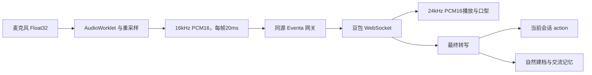

# 语音链路与音频算法

AIRI-046：实时字幕先进入主舞台 `liveMessages`，按ID与原文合并；字幕不等于确认送达，音频结束及队列排空后才替换为确认记录。显示ID与provider item ID分离，VAD先到也不会复用上一用户ID；助手按响应范围去重，不再删掉不同轮次的相同短回答。关闭撤销字幕，打断片段按原规则保存为未完成。见[本轮记录](../memory/sessions/2026-10-29-stage-history-reading.md)。

AIRI-045：原用户话轮与任务结果沿用输入时归属；主动问候、摄像头发声和自动续聊捕获当前人物，不能沿用上一用户话轮。两种路径共用现有音频队列与播放确认，保持一个实时连接。

AIRI-039：Web 应用远端新配置前结束当前实时工作，避免旧配置继续发声；启动、音频、身份及网关鉴权机制沿用原链路。实时语音 Key/音色仍由原台式机网关保存，设备权限不共享。风格持久契约仅抽出并重新导出，见[配置同步](shared-config.md)。

2026-10-11，AIRI-037：舞台关闭停止 PCM、WebSocket、播放、普通麦克风和后台任务；休眠时手动或自动通话启动均被拒绝。启动只检查真实语音网关配置连接，不能据“已就绪”声明厂商鉴权或真人听感通过。新增停止后迟到音频和不能重连回归，见[统一启停](stage-runtime.md)。

2026-10-11，AIRI-036：同会话快照替换映射不再误挂断；启动等待人物会话激活并核对归属。档案等待至多250ms，迟到IO受通话代际和读取序号约束，失败清除旧回顾、独立提示且语音继续。网关恢复清理旧不可用提示。54项浏览器、27项语音包和真实豆包两段短句通过；首次网络故障及真人长时麦克风听感未还原，见[修复报告](../../airi/docs/ai/reports/2026-10-11-voice-and-settings-regression.md)。

核对日期：2026-10-06。范围：原 ASR/TTS、豆包实时语音、会话风格与文字模式。关联任务：AIRI-004、AIRI-007、AIRI-011、AIRI-016、AIRI-021、AIRI-022、AIRI-023。

普通语音是“识别 → 文本对话 → 合成”。实时语音使用独立的听说一体模型，走另一条链路。

## 普通语音

hearing store 管理识别服务、VAD 和转写。真实文本进入普通聊天编排。
speech store、pipelines-audio 和 speech 服务管理合成、优先级、播放与中断。
Stage 把音频分析结果连接到角色口型。设备能力和已配置的服务决定实际可用性。

## 全双工实时语音

PcmFramer 对输入样本做带分数边界的加权平均，再限制到 −1 到 1。
它按正负数范围量化为小端 PCM16。16kHz×20ms=320 个样本，每帧六百四十字节。
这段代码是平均重采样，不包含专门的高阶滤波器或回声消除算法。
返回协议固定为 24kHz 单声道 PCM16。decodePcm16 不接受把 Float32 误当 PCM16。
真实TTS可快于播放返回。RealtimeAudio使用约两秒调度窗口与最多三分钟/8192分片的缓存，排空待调度分片及已调度音源后才释放发言；正常超过十秒的突发不会被当作异常。打断、静音和关闭都清空两级队列。

本机网关保管本地 Key，连接固定豆包上游。保存配置不等于鉴权或音色权限验收。
角色、陌生人身份和裁剪后的近期文字在通话启动时传入。
授权的视觉文字与人物记忆通过 session.update 更新，摄像头图片不走这条语音通道。
豆包快脑生成并表达回答；需要后台工作时原生FC派发已配置的意识模型，见[快慢脑协作](fast-slow-brain.md)。
慢脑复用core-agent与授权工具，结果由豆包在空隙表达，不增加普通TTS。文字模式没有麦克风与音频播放。
session.update保留完整会话、工具与顶层extension；FC的items批次按call_id回传，文字使用speech_text_buffer.commit。
快脑能力投影与慢脑实际模型/搜索门控同源。活动context同时更新instructions与slowBrain，网关重算tools，配置变化不重建连接。原生搜索关闭不等于后台搜索不可用；AIRI-021自动回归验证模型派发、慢脑搜索轮次、空隙播报及播放确认，厂商选择与真人体验不由模拟上游证明。

AIRI-026让快脑在派发参数中拟定人设受理与等待稿，应用保持唯一发声。慢脑结果与续聊也读取当前人物卡；直接朗读不会再次润色。短稿45秒等待与错误诊断见[话痨专题](chatty-conversation.md)。

AIRI-027将自动片段等待改为用户设置的1–120秒，默认5秒。普通帧刷新保留草稿，权限/相遇变化继续隔离。面板按同一门控显示倒计时、倾听、播放和任务优先，活动结果及播放占用为响应状态。无回应阶段仅按真正听到的片段推进，模型负责反思和自然换话题，见[当前报告](../../airi/docs/ai/reports/2026-10-06-chatty-idle-and-reflection.md)。

## 转写与生命周期

2026-10-19，AIRI-043：工具回执核对来源输入话轮。旧任务回执不能取消、抑制或清除新话轮的回答。新输入解除原委托的原生续答抑制，独立完整ASR项目也可识别新话轮；重复同编号项目不另建话轮。前端同样检查回执等待期间是否已有新发言。麦克风上传独立于慢脑状态，结果继续等待输出空隙。见[并行语音报告](../../airi/docs/ai/reports/2026-10-19-parallel-voice-and-group-presence.md)。

AIRI-024的话痨片段复用当前sendSpeech、发言编号、豆包commit和播放确认，无独立TTS或麦克风。插话取消旧准备；UI/模型明确暂停后不自动恢复。片段失败不结束普通语音通话，真实音频/连接错误仍按原流程处理。限制与验收见[话痨专题](chatty-conversation.md)。

增量 ASR 追加文本。完整假设和最终结果替换文本，避免重复自我介绍污染姓名。
只有最终用户转写进入自然学习。会话写入检查用户、角色、会话和代际。
实时通话暂停原 ASR。挂断、切页、隐藏、断线或角色会话变化时清理麦克风和播放。
普通麦克风开关保留用户偏好，不阻止主动模式的相遇自动通话。页面按 realtime.active 暂停普通输入，连接中也不并行运行普通 ASR。
打断取消排队音频。连接超时和背压限制避免无限积累。
助手语音需音频结束及本地队列排空才进入共享事实；被打断整句排除，无法可靠对齐已听到的前缀。
AIRI-023后台结果按至多400字符原样分段朗读权威摘要，每段匹配结束并排空后确认，全部段完成才标记任务送达；中断段排除，明确继续时只重述未确认部分。暂停结果不取消后台任务，用户中断结果后不自动重播。风格进入真实快脑启动/更新及worker请求；自然模式只在较长等待且空闲时补一次真实进度，不替代豆包话轮判断。
应用朗读命令speak含唯一ID。实测豆包chat_tts_text开始/结束带服务端response_id，分片通常无ID，response.done仅有usage；网关按开始/结束映射speechId，旧/重复结束不确认新朗读。FC移交释放responding，应用独占过渡语和结果朗读，已受理任务的原生续答取消。无音频、20秒等待超时、三分钟播报超时和真实格式/积压错误保持失败。
文字显示完成才确认送达。生成完成与送达确认分开；停止后旧结果不能写回或发声。

## 证据与验证

- [hearing.ts](../../airi/packages/stage-ui/src/stores/modules/hearing.ts) 与 [speech.ts](../../airi/packages/stage-ui/src/stores/modules/speech.ts)：普通链路。
- [pcm.ts](../../airi/packages/realtime-voice/src/pcm.ts)：PcmFramer、decodePcm16。
- [doubao.ts](../../airi/packages/realtime-voice/src/doubao.ts)：上游协议、ASR 与取消。
- [gateway.ts](../../airi/packages/realtime-voice/src/gateway.ts)：本机网关边界。
- [realtime-voice.ts](../../airi/packages/stage-ui/src/stores/modules/realtime-voice.ts)：会话接线、转写和视觉更新。
- [实时语音说明](../../开发文档/06-realtime-voice.md)：配置与验证命令。

自动网关测试使用模拟上游。真人往返、音质和真实付费权限见 AIRI-004。
AIRI-022另外通过本机5173新网关调用真实豆包，两段公开短句各收到匹配的音频及结束；重复首段命令只生成一次。它验证真实厂商朗读和ID映射，不代表已测试真人麦克风或真实DeepSeek天气查询。见[播报修复报告](../../airi/docs/ai/reports/2026-10-03-voice-delivery-fix.md)。
当前本机网关适用 Web 开发与 preview。静态托管、Electron 和 Pocket 没有同等网关。

返回 [Wiki 首页](../README.md)。

2026-10-28，AIRI-045：人脸仅更新归档对象，不改变登录、会话或实时连接。ASR 初始部分转写捕获人物，最终转写及助手回合沿用；后台任务、受理语、进度与分段结果沿用受理时的归属。当前人物变化只刷新有界回顾，旧 IO 不得覆盖新范围。真实登录/退出、会话切换与舞台关闭仍按原规则清理。AIRI-034 的人脸联动停话方案已被替代，详见[本轮报告](../../airi/docs/ai/reports/2026-10-28-message-person-archive.md)。

2026-10-06，AIRI-028：首次相遇问候使用greeting事件与同一准备/发声槽位。实际音频排空存一次历史，不计入无人回应试探。视觉变化撤销稿件和自动音频，空闲截止时间保留。详见[修复记录](../memory/sessions/2026-10-06-active-greeting-and-recognition.md)。

2026-10-08，AIRI-032：本机5173网关使用既有配置，真实豆包两段公开短句分别返回163080和75790字节音频，并收到对应audio-done。普通麦克风开启阻塞主动接通已在浏览器复现并修复。厂商返回音频、模拟浏览器联动和笔记本实际听到声音分别验收，当前未取得笔记本修复后的现场回执。

2026-10-08，AIRI-033：快脑系统规则可从实时对话页编辑，保存后进入实际start/context。修改设置版本结束旧通话，避免旧稿继续发声。
后台结果仍由慢脑拟稿、豆包直接朗读，修改结果风格应编辑相应慢脑规则。见[提示词专题](brain-prompts.md)。

AIRI-035：活动快脑引用当前关系的少量档案回顾；需要更多历史或整理时用 spawn_thinking 委托慢脑。整理/删除失效事件使活动通话复核范围并更新回顾，不新增发声队列或人物身份来源。详见[聊天档案](chat-archive.md)。

2026-10-18，AIRI-041：prompts.config.speech进入快脑启动/context、语音模式慢脑以及问候/续聊。默认同时三句/三十字，明确要求详细时例外；纯文字不附加。该规则不截断原生音频、不证明真实模型遵从。姓名候选的空闲核对仍走同一队列。
