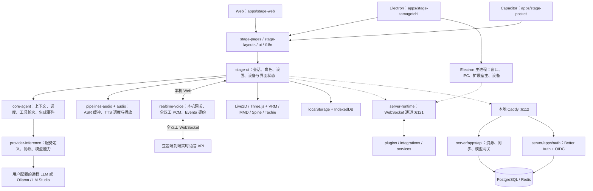
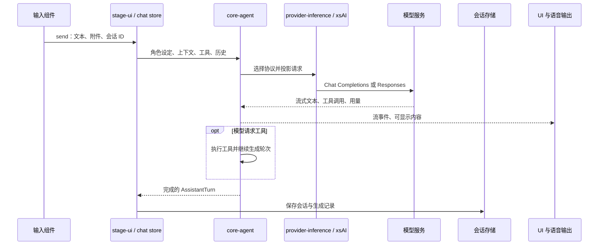
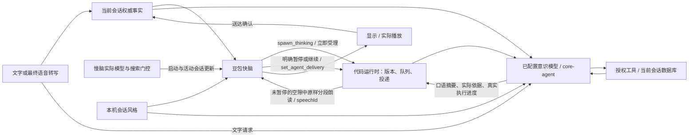
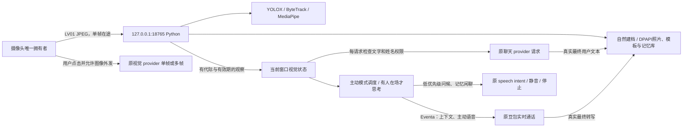
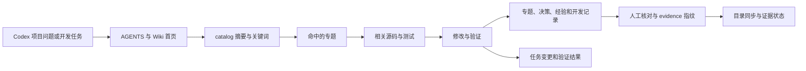
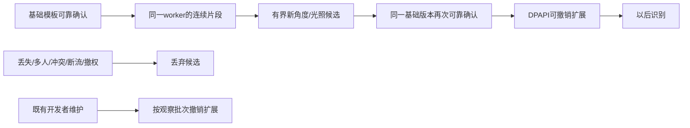
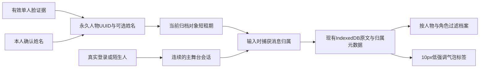
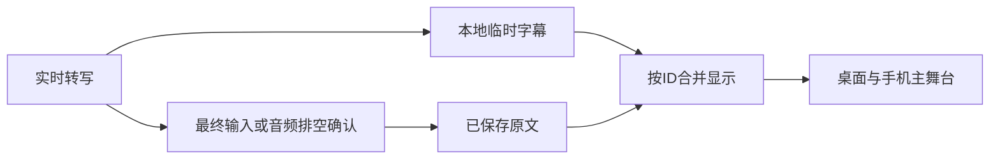

# AIRI 系统架构与源码导航

2026-10-12，AIRI-039：Web 的快慢脑提示词、慢脑模型及采样/思考参数、用户添加的模型服务、对话风格/续聊等待和联网搜索配置，新增台式机统一副本。浏览器 localStorage 仍保存本机缓存、未同步检查点和替换前备份；不同来源不直接互读，而是通过同源 `/api/shared-settings` 交换经过 Valibot 校验的完整配置与 revision。笔记本 `127.0.0.1:4173` 经已有 SSH 转发到台式机 `5173`，保留 Host/Origin；不增加外部账户或修改连接助手。

`SharedSettingsHost` 仅接受回环 TCP、回环 Host、同源来源和 `x-airi-settings`；Windows DPAPI 加密保存 `airi/.local/shared-settings.bin` 及上个加密版本。密钥通过已有 Python 环境的 stdin/stdout 进入系统加密接口，不放进参数或日志。宿主以文件锁、原子替换和 CAS revision 防止多个进程/设备用旧版本覆盖新版本；损坏文件返回不可用，不重建默认配置。`SharedSettingsClient` 在领导窗口去抖提交、每五秒读取，保留断线编辑与刷新检查点；冲突由“配置同步”页明确选择，采用宿主版本前备份本机配置。活动语音在应用远端新配置前结束，模型选择同时写当前角色卡，登录默认值后恢复用户慢脑选择。

摄像头/麦克风权限与设备选择、浏览器语音识别、运行/休眠、hosted 登录、聊天记录和个人身份不进入这份共享配置。实时语音模型/音色/Key 继续由原台式机网关管理。该接线仅覆盖 Web；Electron/Pocket 和旧 LAN HTTPS 未接入本轮同步。双来源验证与真实笔记本现场测试分别记录，见[共享配置报告](../airi/docs/ai/reports/2026-10-12-config-sync.md)。

休眠执行门控同时位于共享输入与 `chat.send/retry/rerunToolCall`；历史重试和工具重跑在改写原记录之前拒绝执行，保留档案浏览与配置入口。

2026-10-11，AIRI-037：Web 舞台增加统一启动/关闭。`stage-runtime` 的同步 action 在领导窗口执行，广播可序列化运行状态；运行偏好持久化关闭外部 storage 事件提案，避免跟随窗口用旧阶段覆盖关闭结果。启动先停止旧工作，再检查视觉进程/模型、真实语音网关配置连接、文字模型配置和本地历史；迟到结果受代际隔离。关闭先停采集、语音、普通输入、自动任务和生成，再请求本机进程休眠；刷新后保持休眠，用户配置与原始聊天记录保留。

宿主 `stage-runtime-gateway.ts` 只接受受同源头保护的固定 wake/sleep 请求，串行调用既有 `vision.ps1`。视觉 `/runtime/sleep` 在无绑定、socket 和查找任务时阻止新绑定，再由脚本核对 PID/启动时间并释放 Python/CUDA；其他客户端占用时报告 busy。网页、设置和轻量网关保留，远程模型请求/连接关闭；不管理第三方服务器、电源、SSH、LAN 或未配置服务。`test-airi-delivery.ps1` 统一重建共享包、回归旧功能、类型/lint、Web 构建和实际服务检查；自动结果与真人音频验收分开记录。

2026-10-11，AIRI-036：舞台全部设置独立于账户显示。语音启动等待当前人物会话激活并复核归属；监听实际归属值，同会话快照不再误挂断。档案等待至多250ms，迟到结果通过context更新，按通话代际和读取序号隔离；存储故障单独提示，不阻塞音频。网关恢复清理旧不可用提示。厂商音频、模拟回归与真人设备分别验收，见[修复报告](../airi/docs/ai/reports/2026-10-11-voice-and-settings-regression.md)。

分析日期：2026-09-29；快慢脑会话策略更新：2026-10-06；Firecrawl免费搜索接入：2026-10-03。基准提交：`2e0e963670e5435a2909149fff1f83b93f8ffd11`。

项目来源：[moeru-ai/airi](https://github.com/moeru-ai/airi)。本地根目录：`F:\codex\数字生命\airi`。
以下结论来自本地源码。目录存在不代表功能已配置、已启用或已完成。

## 1. 项目定位

本地项目由所有者明确指定用于非商业、非盈利的科学研究。模型和上游代码继续遵守各自许可。
AIRI 是数字角色应用与运行框架。它组合模型服务、角色设定、语音、动画和外部事件。
它自身不提供完整的大语言模型权重。模型来自你配置的远程服务或本地推理服务。

仓库采用 pnpm workspace + Turborepo。当前根包加 72 个具名子包，共 73 个工作区。
本地版本删除了 Discord、X/Twitter、Minecraft、Factorio 的功能代码与前端入口，新增 `realtime-voice` 包。
主要客户端使用 Vue 3、TypeScript、Vite、Pinia、VueUse 和 UnoCSS。
桌面端使用 Electron。移动端使用 Capacitor。

## 2. 系统总图

图中实线表示主要调用或数据传递。虚线表示按功能启用的链路。



`server-runtime` 是外部事件通道。`server/apps/api` 是产品后端。二者用途不同。
基础对话可直接请求用户配置的模型服务。此路径不强制依赖 PostgreSQL、Redis 或 AIRI 账号。
账号、云同步及官方模型服务另有后端依赖。上游默认 API 地址为 `https://api.airi.build`。

## 3. 按职责组织的目录

```text
airi/
├─ apps/
│  ├─ stage-web/                 浏览器入口、路由、页面和 Vite 配置
│  ├─ stage-tamagotchi/          Electron 主进程、预加载层与渲染层
│  ├─ stage-pocket/             Capacitor 移动端与 iOS / Android 工程
│  ├─ ui-server-auth/           认证界面
│  └─ component-calling/        组件调用应用
├─ packages/
│  ├─ core-agent/               与 UI 解耦的会话、上下文和生成运行时
│  ├─ provider-inference/       跨 Browser / Node 的模型服务定义
│  ├─ stage-ui/                 共享业务组件、stores、composables、服务
│  ├─ stage-pages/              共享设置页与页面基类
│  ├─ stage-layouts/            共享布局
│  ├─ stage-shared/             共享工具与观测契约
│  ├─ ui/                      基础 UI 组件
│  ├─ i18n/                    文案与翻译
│  ├─ pipelines-audio/          音频流水线与调度策略
│  ├─ realtime-voice/           豆包全双工网关、音频与协议契约
│  ├─ audio/                   音频编码与低层工具
│  ├─ stage-ui-live2d/          Live2D 渲染
│  ├─ stage-ui-three/           Three.js / VRM 渲染
│  ├─ stage-ui-mmd/             MMD 渲染
│  ├─ stage-ui-spine/           Spine 渲染
│  ├─ stage-ui-tachie/          立绘渲染
│  ├─ model-driver-*/          口型、动作或姿态驱动
│  ├─ server-runtime/           外部模块 WebSocket 服务
│  ├─ server-sdk/               外部模块连接客户端
│  ├─ server-shared/            WebSocket 事件与共享契约
│  ├─ plugin-sdk/              扩展 SDK 与 Kit API
│  ├─ plugin-protocol/         扩展协议
│  ├─ plugin-sdk-tamagotchi/    Electron 扩展能力
│  ├─ ccc/                     角色卡相关实现
│  └─ memory-pgvector/         当前入口仍为模块骨架，非现成完整记忆系统
├─ plugins/                    Bilibili、Claude Code、国际象棋、Home Assistant、浏览器扩展
├─ integrations/               Satori、Telegram、VS Code
├─ services/computer-use-mcp/   计算机操作 MCP 服务
├─ server/
│  ├─ apps/api/                Hono API、业务服务、数据库迁移
│  ├─ apps/auth/               独立认证与 OIDC
│  ├─ packages/                后端 schema、基础设施与共享协议
│  ├─ dev/caddy/               本地反向代理
│  └─ docker-compose.yaml      API + Auth + PostgreSQL + Redis + Caddy
├─ engines/stage-tamagotchi-godot/ Godot 相关实验与工程
├─ docs/                       官方文档、设计讨论、ADR
├─ patches/                    上游依赖补丁
├─ pnpm-workspace.yaml         工作区、统一版本与依赖构建策略
├─ pnpm-lock.yaml              精确依赖锁文件
└─ turbo.json                  build / typecheck 的依赖调度
```

完整清单见 [包索引](03-workspace-index.md)、[三层源码目录树](source-directory-tree.txt) 和 [当前源码文件](source-files.txt)。
本地管理工具运行时每 5 秒检测变化，更新机械索引。未提交的新源码文件也纳入目录。

## 4. 客户端启动链路

1. [main.ts](../airi/apps/stage-web/src/main.ts) 创建 Vue、Pinia、同步插件、路由、i18n 和 Tres。
2. [App.vue](../airi/apps/stage-web/src/App.vue) 初始化认证、角色卡、模型、会话与音频设备。
3. 同一入口初始化 WebSocket 通道、上下文桥与角色事件编排。
4. 页面来自 `apps/stage-web/src/pages` 和共享 `packages/stage-pages/src/pages`。
5. [vite.config.ts](../airi/apps/stage-web/vite.config.ts) 配置路由、内部别名、Worker、Live2D SDK 与示例资源下载。

本地修改后，Web 不再自动打开首次注册登录引导。无账号直接进入舞台，页头显示“陌生人”，点击进入服务提供商设置。
共享引导组件仍保留服务配置和“以陌生人身份继续”，不再提供欢迎页登录按钮。移动端访客入口也进入服务配置。
原有认证与后端访问检查保留；真实账号的状态和云端服务未被伪造。

[user-account.ts](../airi/packages/stage-ui/src/stores/chat/context-providers/user-account.ts) 每次模型请求生成身份上下文。
访客使用 i18n 中的 `base.guest.name`，并保持 `auth.isAuthenticated = false` 和本地 `userId = local`。
登录账号使用真实显示名；退出后下一次请求只注入访客身份。该上下文不存入持久化上下文注册表。

桌面端从 [main/index.ts](../airi/apps/stage-tamagotchi/src/main/index.ts) 启动。
主进程通过 `injeca` 组织服务，注册窗口、扩展宿主、MCP、快捷键和通道服务。
IPC 契约放在 `apps/stage-tamagotchi/src/shared`，跨进程通信使用 Eventa。

## 5. 一次文本对话的调用链



关键文件：

| 源码 | 责任 |
| --- | --- |
| [stores/chat.ts](../airi/packages/stage-ui/src/stores/chat.ts) | UI 状态与核心运行时之间的适配 |
| [use-chat-input.ts](../airi/packages/stage-ui/src/composables/use-chat-input.ts) | 本地桌面/移动文字入口：按设置进入豆包快脑或普通模型；无配置时给出可操作提示 |
| [chat-orchestrator-runtime.ts](../airi/packages/core-agent/src/runtime/chat-orchestrator-runtime.ts) | 发送队列、上下文组合、生命周期和流处理 |
| [ai/chat-llm/llm.ts](../airi/packages/stage-ui/src/stores/ai/chat-llm/llm.ts) | 调用 core-agent 的 `streamFrom` |
| [core-agent/runtime](../airi/packages/core-agent/src/runtime) | 协议适配、生成、标记解析与响应分类 |
| [provider-inference/src/providers](../airi/packages/provider-inference/src/providers) | 云端与本地模型服务定义 |
| [chat/session-store.ts](../airi/packages/stage-ui/src/stores/chat/session-store.ts) | 本地历史与登录后的云同步 |
| [chat/context-store.ts](../airi/packages/stage-ui/src/stores/chat/context-store.ts) | 上下文状态 |
| [chat/context-providers](../airi/packages/stage-ui/src/stores/chat/context-providers) | 运行提示词与账号/陌生人上下文 |

核心数据是 `Conversation → Turn → AssistantTurn.rounds`。
一轮对应一次模型调用及其工具执行。原生协议续传信息与显示文本分开保存。
该提交的 `core-agent` README 明确说明：原生 Realtime transport 尚未实现。
本地新增豆包适配器位于独立的 `realtime-voice` 包，不代表 core-agent 已实现所有厂商的原生实时协议。

## 6. 语音与角色表现

输入方向：麦克风 → VAD/ASR → 转写片段缓冲 → 文本对话。
输出方向：模型流 → 文本/情绪标记 → Speech Intent → TTS/播放 → 口型与角色表现。

| 开发目标 | 入口 |
| --- | --- |
| 转写服务选择、VAD、流式识别 | [stores/modules/hearing.ts](../airi/packages/stage-ui/src/stores/modules/hearing.ts) |
| TTS 服务、模型与声音设置 | [stores/modules/speech.ts](../airi/packages/stage-ui/src/stores/modules/speech.ts) |
| 豆包听说一体、通话与 API 配置 | [stores/modules/realtime-voice.ts](../airi/packages/stage-ui/src/stores/modules/realtime-voice.ts)、[realtime-voice 包](../airi/packages/realtime-voice/README.md) |
| 播放队列、优先级、中断 | [packages/pipelines-audio](../airi/packages/pipelines-audio) |
| 跨窗口语音宿主与事件 | [services/speech/pipeline-runtime.ts](../airi/packages/stage-ui/src/services/speech/pipeline-runtime.ts) |
| 角色渲染入口 | [components/scenes/Stage.vue](../airi/packages/stage-ui/src/components/scenes/Stage.vue) |
| 外部通知驱动角色反应 | [character/orchestrator/store.ts](../airi/packages/stage-ui/src/stores/character/orchestrator/store.ts) |

具体音频接线由客户端与组件生命周期完成。硬件能力、模型下载、麦克风权限和服务配置会影响可用性。

实时通话链路：麦克风 → AudioWorklet（16 kHz PCM16，20 ms）→ 同源本机 WebSocket 网关 → 豆包。
返回的 24 kHz PCM16 接入播放、静音和口型；转写进入现有会话 action。通话携带角色设定、访客身份和裁剪后的近期文字。
通话期间暂停原听觉绑定；切换角色/会话/页面、隐藏窗口和断线均结束通话。
实时快脑由豆包听说一体模型响应；需要记录查询、工具或持续思考时，通过原生 FC 派发慢脑。
慢脑复用意识模块选择的模型、core-agent 与已授权工具，新增当前会话的只读数据库查询，无协调大模型。
搜索需要独立接线：豆包快脑当前固定关闭原生搜索。普通对话和慢脑复用 `web_search`，网络搜索设置允许选择 Firecrawl 匿名免费入口，或已配置 Key 的 Tavily；总开关默认关闭。DeepSeek 使用 Chat Completions，由模型发出函数调用，项目执行真实搜索，再交回工具结果，不按问题关键词伪造查询。

Firecrawl通过Web同源 `/api/web-search/firecrawl` 网关查询。未填写Key时，主机执行已安装的官方CLI匿名搜索；填写Firecrawl账户Key时，主机请求官方 `/v2/search`，不再由浏览器直接匿名跨域请求。两条路径只查web、最多10条，不附加抓取。网关限制本地同源、请求大小、并发与超时，断开连接取消上游，只转发显式Firecrawl凭据，不转发Cookie或LAN票据。当前宿主覆盖Web开发和preview及既有LAN代理，纯静态页面、Electron和Pocket尚无对应搜索宿主。

权限、额度、限流或网关错误保留真实原因并脱敏，模块暂停后续模型搜索请求，直到用户修改配置或手动测试。配置代际隔离迟到的错误、结果和余额；取消不会产生成功回执。慢脑解析工具后再组合系统提示，第一次请求也带搜索指导，不把搜索服务失败推断为整机断网。网页标题和摘要作为不可信数据，URL、服务端消耗和请求ID进入工具证据；快脑只接收后台确认结果和来源。

设置页提供官方注册/控制台、独立Firecrawl Key、实际测试来源/请求ID/消耗，以及经官方 `/v2/team/credit-usage` 查询的账户余额。Key保留当前浏览器缓存，并由AIRI-039的Web同步保存到台式机DPAPI加密副本，与Tavily分开；回执和余额只在内存。免费账户每月1,000 credits与更低的匿名限额不同，不自造余额、不自动升级或充值。余额接口不能证明账户套餐或自动充值状态，用户须在官方控制台选择Free。AIRI-020已实测本机网关南宁天气来源与浏览器按钮成功；当前测试浏览器未配置慢脑，真实DeepSeek/真人语音未验收。见[403修复报告](../airi/docs/ai/reports/2026-10-03-firecrawl-403-fix.md)、[历史接入报告](../airi/docs/ai/reports/2026-10-03-firecrawl-search.md)。
`BrainRuntime` 维护有界事实、任务ID/版本、90秒超时与结果；结果保存在应用运行时，取得发言权、实际播完和进入模型确认上下文是独立步骤。待播结果不把摘要或建议发言同时交给快脑模型，避免模型生成和应用直接朗读形成两次输出；已送达与context_only结果才投影到模型上下文。
慢脑的 `ThinkingCapabilities` 从实际模型选择和 `web-search.configured/lastFailure` 门控生成，不含Key，也不表示联网已成功。快脑在启动和每次有序更新时读取这份配置：搜索启用时由模型发出 `spawn_thinking`，不能因自身原生搜索关闭就拒绝整个智能体联网。停用或实际服务错误分别投影为disabled/blocked；历史拒绝不覆盖当前能力。`context` Eventa命令同时带必需的 `slowBrain` 布尔值，网关在完整 `session.update` 中重算 `session.tools`，保留model/audio/extension，通话无需为工具配置变化重新建连。首页“快慢脑协作”面板显示同源能力状态和网络搜索设置入口。AIRI-021的工程闭环回归通过，真实豆包FC选择与真人体验另行验收；见[语音联动修复](../airi/docs/ai/reports/2026-10-03-voice-slow-brain-link.md)。
闲聊继续不取消任务，改版/取消和生命周期变化使旧结果失效。语音以实际播放排空确认送达，打断整句不进入事实。
应用接到真实受理回执后，在用户不说话且空闲200ms时朗读一次快脑按人物卡拟定的acknowledgement，每个任务版本去重。已迅速完成的任务省去受理语，直接等空闲700ms反馈结果。FC移交释放快脑生成状态，已受理工具续答取消并由应用统一安排发言；不编造进度或重复夸赞。
`conversation.ts`在既有实时语音包内提供会话策略投影，设置保存在本机。自然协作、简洁办事、陪伴倾听进入真实快脑启动/更新上下文和慢脑请求；基础模式关闭新增表达策略与等待提示，保留事实、任务与安全投递。模型依上下文理解情绪，当前用户请求优先，不增加关键词情绪分类、协调模型或独立服务。

AIRI-024增加“活泼话痨”：沿用当前人物卡，高主动表达、低回应索取，分享具体看法和联想，不把沉默写成人物偏好或认可。选择只修改风格，不自动申请麦克风或开通服务。
活动语音通话达到用户设置的安静时长后，现有realtime store向已选慢脑请求一个80–180字为目标、至多400字符的口语续聊片段。等待默认5秒，支持1–120秒、5/10秒快捷选择和当前浏览器持久化；修改重排未开始的计时，不中断正在准备的稿件。请求通过core-agent，只有明确应用事件的system输入、当前人物/陌生人身份、近期确认事实和既有授权视觉文字，不伪造user轮次，也不注册工具或联网。正式任务、用户话音、原生响应及播放占用优先。
候选经schema及当前会话/角色/身份/模型/代际核对后，使用同一sendSpeech和豆包commit队列，音频结束与本地排空后才进入共享事实。只有一份待准备片段，无预生成长队列。用户开口、换风格或模型使旧候选失效；手动打断、暂停/静音使自动发声暂停，后台任务继续。既有set_agent_delivery按用户明确要求控制自动闲聊和结果，不新增停说关键词分类器。
AIRI-026将短稿改为纯口语文本，显式关闭该请求的深度思考，正式任务仍遵循持久设置。自动请求每通话至多30次，含中止和失败，单次45秒超时后停止自动重试。面板显示脱敏HTTP状态与错误类别，语音设置提供独立短稿测试，不以旧布尔提示猜测历史原因。原有10分钟上限、挂断/隐藏/导航/角色和会话隔离保留，不自动重连续费。纯文字只采用话痨表达，无自动闲聊。摄像头companion保留观察和授权上下文，在活动话痨通话中让出主动发声调度，防止两个循环抢话。当前限额是工程预算，不宣称全天运行或普遍舒适度。详见[话痨模式报告](../airi/docs/ai/reports/2026-10-04-chatty-conversation.md)。
慢脑在真实工具开始、返回、抛错边界报告`ThinkingProgress`，与排队/模型处理共同形成有界进度；旧任务版本的进度无效。不向快脑泄露推理、原始参数或返回正文。自然模式在受理约15秒后，仅空闲时朗读一次快脑拟定的waiting_utterance，未提供稿件时仅显示实际进度；不是心理学沉默阈值，不承诺百分比或完成时间，已完成结果优先。
快脑派发参数中的acknowledgement和waiting_utterance、慢脑任务与续聊均受当前人物卡和各自职责提示引导。语音设置新增人物卡编辑入口，系统提示不是逐句遵循的保证。模型遗漏受理稿或语音文字任务使用中性真实回执，不再随机选套话。详见[AIRI-026报告](../airi/docs/ai/reports/2026-10-06-chatty-preparation-and-persona.md)。

AIRI-027将视觉投影拆成观察文字和授权/相遇scope。普通帧时间、物体、动作变化更新快脑及后续候选，不取消当前续聊；权限、采集来源、主人物、姓名确认状态变化或观察撤回仍使旧候选失效。scope由local-vision store生成，local-vision-runtime注册，companion监听边界变化，slow-brain在请求前后验证。旧实现比较全文，持续摄像头帧会取消或拒绝合法草稿，自动回归已先复现再修复。
运行时只统计本地排空且匹配音频结束的自动片段。新真实用户转写归零。首次无人开口先分享，之后最多两段轻试探机会，再切换新话题并展开。模型按上下文私下考虑措辞、话题匹配、忙碌或倾听等可能性，不把沉默写成情绪诊断、偏好或长期记忆。打断的稿件不占已听机会，语义判断不由关键词规则替代。
协作面板与实际门控共用continuationStatus，显示等待倒计时、倾听、播放、任务优先、生成、配置缺失或错误。活动结果与播放占用为响应状态，送达后能解除阻塞。新增提示扩大后，16000字符上下文预算优先保留策略及有效事实/任务JSON，再容纳人物与视觉，不裁断结构数据。详见[AIRI-027报告](../airi/docs/ai/reports/2026-10-06-chatty-idle-and-reflection.md)。
慢脑直接生成口语化的权威`result_summary`，保留数字、单位、否定、条件和不确定性；文字显示和语音都用同一摘要。`suggested_utterance`仅保留结构化预览，不作为第二份事实稿。较长摘要按至多400字符原样分段朗读，全部分段匹配结束并播放排空才确认任务送达。已确认分段进入事实；中断段保守排除，明确继续时只重述未确认部分。此约束防止二次表达改写，但不证明模型摘要一定真实。
播报暂停独立于任务取消。用户打断后台结果后暂停自动投递；首页提供暂停/继续结果按钮，快脑也可按当前用户请求调用`set_agent_delivery(paused|automatic)`。后台继续执行、结果仍保留，需明确恢复才播；取消仍带任务ID/版本，挂断等生命周期仍结束工作。暂停状态同步快脑，避免借另一条输出路径重复回答。
`speak`带应用发言ID。豆包实测朗读开始的`tts_type=chat_tts_text`及服务端response_id映射到该ID，音频分片和匹配的结束事件带回speechId；无编号的response.done不能确认当前朗读，重复和已中断事件不能确认新结果。只有匹配结束且本地音频排空才确认送达。音频采用短窗口调度与有界缓存，正常超过十秒的TTS突发不挂断；格式错误、三分钟积压、空音频和超时分别报告。
首页协作面板为绝对定位的悬浮层，默认收起详细任务，展开内容在有限高度内滚动。面板不占舞台纵向空间，人物和聊天框不随任务或转写高度变化。
文字默认交给已选慢脑与同一事实/任务运行时，纯文字不连接豆包或申请麦克风；语音通话中由豆包读出文字任务结果。实测豆包的文字事件是朗读，不能替代文字模型。图片和普通模型仍有原路径，视觉文字继续受权限控制。
仅 Web 本机服务/preview 提供网关。详见 [实时语音说明](06-realtime-voice.md)。



慢脑私有推理与原始数据库返回不写入快脑共享事实。当前任务只在连接窗口内存中存活，挂断后结束。
模型是否已选择、自动协议测试是否通过、真实服务是否可用和真人体验是否验收分别记录。

## 7. 配置、数据与记忆的边界

| 数据 | 当前实现 |
| --- | --- |
| 服务地址、API Key、模型配置 | `stores/providers/config.ts` 保留 localStorage；Web 用户配置经 shared-settings 共享加密宿主副本，原登录云副本保留鉴权规则 |
| 豆包实时语音 Key | 例外：保存于本机 `airi/.local/realtime-voice.json`，Git 忽略且 Vite 拒绝文件读取；不进入浏览器配置导出 |
| 角色卡和角色设定 | `stores/modules/airi-card.ts` |
| 本地聊天历史 | `database/repos/chat-sessions.repo.ts` |
| 本地持久化驱动 | `database/storage.ts`，IndexedDB 的 `airi-local` 与 `airi-sync-queue` |
| 云端会话同步 | `stores/chat/session-store.ts` 与 `libs/chat-sync` |
| 向量记忆模块 | `packages/memory-pgvector/src/index.ts` 目前只是连接与配置事件骨架 |

浏览器存储按来源隔离。`localhost:5173` 与 `127.0.0.1:5173` 的缓存不会直接互读；AIRI-039的Web共享配置经同源宿主同步，历史和设备偏好仍独立。
本部署统一使用 `127.0.0.1:5173`。

持久化聊天原文现由 AIRI-035 的聊天档案提供按人物和智能体的跨会话检索、整理及有界回顾。自动事实提取与向量语义检索仍未实现。
不要根据 `memory-pgvector` 目录名称推断这些流程已完成。

## 8. 扩展边界

外部进程连接 `server-sdk`，通过 `server-runtime` 传递 `input:text`、`context:update`、`spark:notify` 等事件。
默认通道为 `ws://localhost:6121/ws`。前端可用 `VITE_AIRI_WS_URL` 设置初始地址。

桌面 Extension 使用 `plugin-sdk`。扩展根目录声明 `extension.airi.json`，当前宿主只接受 Manifest v2。
Kit API 封装宿主能力。跨进程 Kit 复用 Eventa 契约。
完整示例见 [plugin-sdk/README.md](../airi/packages/plugin-sdk/README.md) 及桌面 `services/airi/plugins/examples`。

账号后端从 `server/apps/api/src/routes` 进入，业务逻辑主要在 `services/domain`。
修改后端边界前，先阅读 [server/AGENTS.md](../airi/server/AGENTS.md) 和对应 ADR。

## 9. 阅读顺序

建议依次阅读：Web 入口 → `stage-ui/stores/chat.ts` → `core-agent` → `provider-inference` → 语音 → 渲染 → 外部扩展。
如果只改角色设定或 UI，先阅读 [二次开发指南](04-development-guide.md) 的定位表。

## 10. 本地项目管理

工作区增加独立的 Node 内置 HTTP 服务 `scripts/project-manager.mjs`，监听 `127.0.0.1:5174`。
浏览器工作台 → 本机任务 API → `项目管理/tasks.json` → 看板与变更记录。
源码扫描 → `generate-project-index.mjs` → 包索引、目录树、当前文件与改动列表。
此服务不进入 AIRI 的运行时依赖，不影响聊天后端或模型调用；停用后 AIRI 仍可单独运行。
配置、启动和维护规则见 [项目管理与目录同步](05-project-management.md)。

## 11. 本地社交视觉

新增 `packages/local-vision` 和 `services/local-vision`，正式入口在共享视觉设置页。
Windows Web 的主窗口持有摄像头，设置页和角色舞台使用同一个非同步 Pinia store。



Vite 同源控制网关保管本地服务凭据，浏览器只获得短期一次性帧通道票据。
本地服务不接收任意 URL 或文件路径。原始画面不进入 BroadcastChannel、上下文 registry 或历史。
观察有效期至多两秒。切换角色、关闭采集或撤销权限使旧证据失效。会话切换移动投影并取消旧工作，连续采集保持运行。
视觉文字在诊断记录之后、模型请求之前临时加入。派生回复排除后续模型历史与云消息同步。

默认主动模式，主窗口自动请求摄像头并持续本地识别。模式选择保存在本机，舞台按钮可切换被动模式。
摄像头维护使用独立的 250 毫秒时钟，等待麦克风授权或模型回复不再阻塞启动和恢复。
先初始化访客会话，再绑定摄像头。状态区分模型已加载、摄像头已开启等待结果和实际处理帧数。
被动模式关闭摄像头并取消尚未完成的主动思考和输出。角色变化重新绑定采集，账户和会话切换保留摄像头。
单人清晰可见时，真实文字或最终转写中的姓名先进入候选状态。本人确认文字后，至少十个一致清晰样本保存人脸模板。
交流中补充正面、左右转头的裁剪照片和角度模板。照片、模板、记忆正文用 Windows DPAPI 加密。
SQLite 用持久人物 ID 管理姓名和相遇时间，按人物、角色隔离最多八十条真实用户交流记忆。
初始匹配采用较严格的相似度、候选间隔和多帧确认。手工校准是可选质量评估，不再阻止普通社交叫名。
确认与保持使用不同阈值。AIRI-044 将短时模糊保持上限调整为 2.5 秒，以覆盖每秒一次采集中的一次质量拒绝。
图库分数跌落时，仅同一单人轨迹、同一唯一候选、与最近独立确认向量余弦至少 0.80，才允许有界保持。
参考最多存活 2.5 秒，弱帧不续期、不登记、不写社交样本。丢失、多人、冲突、身体框跳变和重置清除参考。
不同人脸、多人歧义和超时重新确认。检测短暂漏检只保留内部证据，不输出虚构人物。
识别与入库质量分开：中等质量帧只用于匹配，清晰大脸才用于登记、照片和角度补充。
重新介绍时，十个新样本必须与唯一已有档案高度一致才复用人物 ID，保留其照片与记忆。
仅姓名相同不合并人物。重复介绍标记的异常姓名不入库。
轨迹 ID 不作为持久身份。多人交叠时撤回确认；单人时才运行首版脸部与手部动作分析。
`companion.ts` 根据稳定在场、用户活动和冷却调度问候与闲聊。默认最短间隔五分钟，用户活动后至少安静一分钟。
只在用户实际说话、转写中或助手回答时暂缓。麦克风开启和通话空闲本身不阻止主动交流。
问候不伪造用户消息。主动回复可见于本地历史，标记 `localVisionDerived` 并排除后续模型历史及云同步。
人物与模式监听比较标量，普通新帧不会取消正在读取记忆的问候。文字问候不要求持有音频宿主权。
人物确认后，聊天请求及实时 `session.update` 获得有有效期的观察与有界记忆。引文作为数据，不获得指令权限。
实时通话进入可接收上下文的状态、档案读取完成或姓名学习变化时立即更新，避免启动时丢失姓名。
实时 ASR 的增量事件追加文本，完整结果和最终结果替换文本。自然建档只消费最终结果。
闲聊思考复用已配置聊天模型，见面问候有本地文字模板。无聊天模型时不会假装产生自由对话。
已有实时语音配置时，见到人可接入一次通话，复用官方 `speech_text_buffer.commit` 主动发声。
普通麦克风开关不阻止自动通话。实时连接从 connecting 起暂停页面普通 ASR，保留麦克风偏好，挂断后恢复原输入绑定。
自动通话在无人三十秒、被动模式、后台或十分钟上限时结束，同一人在场期间不会无限自动续费重连。
默认不向外部服务发送摄像头图片。手动“看一下”继续走独立图像权限。

服务在本机离线推理，API 看图仅按需调用已有服务商。Grounding DINO 提供单独的显式准备命令。
实际验证状态、自然建档、部署及未测范围见 [本地社交视觉](07-local-vision.md)。
2026-10-01 起，本机使用 YuNet、EdgeFace S 与 ByteTrack，保留 SFace 作为登记模板空间。
`recognition.py` 管理 ONNX 编码器、独立模型索引、质量加权多帧证据和特征提取时钟。
前端每秒最多发送一帧进行本地推理，仍只允许一帧在途，繁忙时跳过，不补发积压帧。
服务端保留最高五次每秒的检查能力，当前 Web 输入限制为每秒一次。视频预览帧率与送检频率分开。
稳定确认后的特征调度保留，画面变化和学习不会越过前端每秒一次的上限。
加权融合先检查当前帧的独立支持，陌生人或歧义不能被旧高分覆盖。多人、过期和撤销清空证据。
EdgeFace 的 512 维索引按人物、模型 hash、角度存入 `recognition_templates`，由已有加密裁剪在本机重建。
原有 128 维 SFace 模板、姓名、照片、相遇和记忆继续保留。新介绍与补充角度只按需提取 SFace 登记特征。
服务启动时核查固定权重与许可 hash，运行请求不下载模型。当前选择写入忽略目录的 `recognition.json`。
`/metrics` 追加模型、实际提取与跳过计数，健康状态和摄像头连接仍分别判断。
模型对比与限制见 [本地社交视觉](07-local-vision.md) 和 [降频识别 ADR](../airi/docs/ai/adr/2026-10-01-adaptive-face-recognition.md)。

Web 舞台使用摄像头人脸替代鼠标跟随。YuNet 输出 `face_bbox`，使用未镜像画面的归一化坐标。
位置来自每秒一次的送检结果，与姓名、特征提取和入库质量分开。未知人物也能成为注视目标。
`FaceGaze` 按明确主目标、原轨迹、最大可见脸选择，镜像水平坐标并作时间平滑和微小位移过滤。
短暂漏脸保持至多 250ms。画面含往返延迟超过 1500ms 或观察自身有效期、关闭主动模式或撤权时释放。
`useFaceGaze` 的局部 RAF 将位置传给 Stage，再由 Live2D/VRM 根据实际画布边界转换。
Live2D 通用动作模式持续驱动目光与头部，不使用鼠标的一秒静止超时。
VRM 在动画之后、humanoid 更新之前叠加受限头部转动，每帧先恢复原姿态，防止旋转累积。
注视位置不进入聊天、记忆、截图、跨窗口同步或云服务。无目标时恢复原有闲置行为。

## 12. 笔记本通过局域网或 UU 测试

可选的局域网 HTTPS 网关使用 5443，5442 提供公开证书安装页面。
地址、证书 SAN 和防火墙本机地址必须一致。2026-10-08 主机 DHCP 地址从 `192.168.1.5`
变成 `192.168.1.2`，旧网关和证书仍使用旧地址，原私人链接不再作为当前连接助手入口。
网关使用私人访问链接设置受保护 Cookie，检查精确 Host 和 Origin 后转发至回环 Vite。
Web、语音网关和视觉服务继续仅监听主机回环地址。

笔记本浏览器 → HTTPS/WSS 网关 → 回环 Vite → 主机语音网关和视觉控制代理。
笔记本摄像头 → 同源 WSS `/api/local-vision/stream` → Vite 代理 → 主机 Python 视觉推理。
认证边界位于 TLS 网关。上游来源转换为可信回环来源，现有付费服务鉴权和一次性视觉票据继续生效。
浏览器的安全上下文来自已信任的 HTTPS，麦克风和摄像头属于笔记本。
视觉启动按安全上下文检查浏览器能力，采集归属仍由窗口领导权与摄像头锁管理。
模型推理及实时语音网关属于主机，浏览器设置和历史则属于各自设备。
直接使用局域网 HTTP 会因 Web Locks 不可用而白屏。
启动、权限和功能限制见 [局域网测试指南](08-lan-testing.md)。
现有 `connect-airi-laptop.cmd` 保留 SSH 双端口转发作为备用方式。

跨网络连接助手以固定笔记本来源 `http://127.0.0.1:5173/` 访问。
家庭 LAN 连接主机当前 SSH 地址，室外经 UU 把笔记本 22022 映射到主机 `127.0.0.1:22`。
内部 SSH 转发把浏览器 HTTP/WS 送到主机 `127.0.0.1:5173`，原语音、搜索、视觉和开发者鉴权继续生效。
SSH 核对固定主机公钥并执行原密钥鉴权，UU 设备在线不能替代此验证。
主机 SSH 当前监听回环和 `192.168.1.2`，原 SSH 防火墙远端范围保留，只更新本机地址。
SSH 回环入口不依赖主机家庭地址，摄像头与麦克风仍由笔记本浏览器采集。
`scripts/start-airi-background.ps1` 分离远程恢复命令与前台 Web 生命周期，复用健康服务，
后台启动缺失 Web、按需启动视觉，并等待真实同源视觉 `ready=true` 后返回。
它登记 Web 进程身份，不开放 Vite 或 Python 到公网。
2026-10-08 用户转回公司网络 SSH 登录、网页 HTTP 200、视觉 ready 的现场结果。
家庭 LAN 和真人设备、模型通话验收仍需分别完成。

## 13. 管理 Wiki 与开发记忆

工作区 [Wiki 首页](../wiki/README.md) 是跨对话知识入口，独立于角色运行时。
首页按问题路由到职责专题，再进入源码证据。模块、算法、数据流、决策和成长经验分别维护。
现有开发文档保留详细说明，机械索引保留完整目录。Wiki 负责解释与小范围定位。



`scripts/project-wiki.mjs` 使用 Node 内置模块，提供 find、show、check、review 和 sync。
catalog.json 保存专题摘要、关键词和来源路径。evidence.json 保存人工核对声明与 SHA256。
源码、正文或条目变化会标为待复核。自动同步不会刷新人工核对基线，也不会自动撰写架构。
index.md 和 index.json 是生成文件，排除在变化触发源之外，避免循环同步。

本机管理服务提供 `/api/wiki`、`/api/wiki/page/:id` 与 `/api/wiki/source/:id/:index`。
页面与源码只从 catalog 白名单读取，保留回环 Host 检查和现有任务 CSRF 边界。
浏览器使用 DOM 文本渲染，不执行 Markdown 中的 HTML、脚本或 Mermaid 定义。
Wiki 只读。编辑由工作区文件工具完成，开发记录关联任务编号。
本轮没有新增角色模型工具、语义向量检索或模型训练。运行时人物记忆仍由原视觉服务管理。

## 14. 姓名确认与开发者记忆管理

AIRI-025 将姓名确认习惯存为同一 SQLite 中的 `behavior_rules`，通过当前社交上下文进入普通聊天与实时语音。
`SocialLearning` 保留候选拼写和轨迹范围，经过 confirming/correcting/confirmed 才允许登记或更新姓名。
`name_confirmations` 保存确认记录。已有档案无确认记录时再次相遇补问，原人物数据不删除。
明确错字替换或完整姓名修正后再次确认，以原人物 ID 改名。照片、模型模板、相遇和交流记忆保留。
多人物、轨迹变化、超时与拒绝记忆清除候选。普通观点中的“不是”不会被当成姓名纠错。

浏览器管理页 → 同源 `/api/local-vision` 代理 → Python 开发者会话 → 既有 SQLite 仓库。
记忆页与长期记忆模块管理行为规则、姓名和按角色隔离的交流正文。短期页面显示已加载浏览器历史。
数据库与数据页增加表统计，保留原有数据导出、导入和重置入口。
人物与数据库维护区只在开发者会话有效时挂载内容。AIRI-035 的长期记忆聊天档案允许本人浏览，其他人物的档案仍需开发者授权。Python 对管理 API、人物总表和手工登记再次验权。
性能统计保留原诊断能力，含姓名的观察仅向开发者返回。

本机账号配置在忽略的 `.local/vision/developer-auth.json`，只保存用户名、随机盐和 scrypt 摘要。
一小时 HttpOnly/SameSite Cookie 不进入 Pinia 同步、模型上下文、导出、任务或 Wiki。退出与服务重启撤销会话。
LAN 仍经既有 TLS 入口。社交姓名和人脸匹配不授予开发者权限，也不替代 hosted 账号认证。
当前单人对话的有界记忆读取、本人纠错和拒绝记忆仍由原归属规则控制，普通入口继续叫陌生人。
浏览器 IndexedDB 与主机文件受设备权限控制，应用登录不能阻止设备所有者直接读取它们。
长期事实提取、语义搜索和跨设备同步尚未实现，建设顺序见[中文报告](../airi/docs/ai/reports/2026-10-05-memory-management.md)。

## 16. 主动问候修复与人脸轨迹补采（2026-10-06）

AIRI-028将首次摄像头问候接入话痨实时运行时的同一准备/发声槽位，只有周期性摄像头闲聊让位。
greeting应用事件携带人物与授权观察，匹配音频排空才进入一次历史，不消耗无人回应试探次数。
视觉scope变化取消已捕获上下文的稿件与自动音频，保留未捕获数据的空闲计时截止时间，修复最后五秒重排。
AIRI-028 原确认窗口为两秒。AIRI-044 为每秒一次输入调整为 3.5 秒，样本间隔超过 1.5 秒重新收集。
首次确认仍需三个独立、一致且达到原相似度与候选差的样本。候选换人立即清空旧候选计数。

AIRI-029保留原检测/编码器，在同一worker增加TrajectoryLearning，区分基础模板、内存候选和可撤销扩展。
基础身份前后各三次可靠匹配、单人连续可见、无丢失/冲突/版本或权限变化，才允许候选写入face_extensions。
扩展参加普通识别，不能担保下一轮扩库。原已认识人物的单帧add_pose不再自动改变基础，明确介绍登记保留。
每轮最多三个条件代表，每人物模型最多十二个扩展。基础照片、姓名和交流记忆不覆盖。
严重模糊、曝光和失脸拒绝采样，跟踪状态不附带姓名、人物ID或私人记忆，不扩大对话授权。



帧结果新增nullable recognition与adaptation本地诊断，不进入模型投影。前端显示真实帧间隔计算的采集速度和失败原因。
服务metrics保留最近200帧类别计数，无图像或人物标识。新分级区分face-blurry与face-exposure。
GET /admin/persons/{person}带补采批次数量，DELETE /admin/persons/{person}/face-extensions/{round_id}受既有开发者会话保护。
选型与工程参数见[决策](../airi/docs/ai/adr/2026-10-06-trajectory-face-adaptation.md)，真实证据与未验收范围见[报告](../airi/docs/ai/reports/2026-10-06-trajectory-face-adaptation.md)。


## 17. 可编辑的快慢脑系统提示词（AIRI-033）

实时对话页新增提示词编辑器，中文默认值与Valibot契约由realtime-voice/prompts统一持有。
共享brain-prompts store提供config/save/reset/revision，完整快照只保存在当前浏览器域名。
前端草稿不直接改变模型规则，校验保存后进入快脑启动/更新、慢脑任务与问候续聊三条请求。
人物卡仍提供共同身份；所选风格、工具提示和账号资料按现有链路组合。
恢复默认先改草稿。活动通话或文字模式期间UI禁止保存，程序接口改版本会清理旧通话。
续聊校验提示词revision，迟到稿不能越过保存版本发声。原任务版本和唯一播报调度继续生效。
后台JSON格式、续聊输出schema、实际工具权限与音频完成规则仍由运行时执行。
预览使用实际规则来源，但不含完整运行时事实、视觉和任务资料，不记录模型私有推理。
接口、长度上限与真实验证见[ADR](../airi/docs/ai/adr/2026-10-08-brain-prompt-editor.md)和[报告](../airi/docs/ai/reports/2026-10-08-brain-prompt-editor.md)。

## 18. 人脸关联的舞台本地账户（AIRI-034）

**2026-10-28，AIRI-045 已替代本节的自动账户/会话切换。** 下文保留原设计背景，当前规则见后面的“逐消息人物归档”。原 `local-face:<person_id>` 历史分区继续作为支持的档案归属读取，不再作为人脸登录。

Web 采集窗口把新鲜、同代际、清晰单人的确认结果交给共享 `stage-identity` store。
姓名、人脸和观察权限必须同时有效。多人、未确认姓名、纠错、撤权、离开或停机均回到陌生人。
身份采用最多两秒的短租期，窗口停止发布时也会失效。同人续约预留 1.2 秒等待下一帧，重复观察的毫秒抖动不广播。
只同步人物 ID、姓名和租期，不广播画面、模板或人物记忆。内部确认参考与浏览器观察租期分别计时。

右上角 `HeaderAvatar` 显示当前姓名，并连接视觉设置。未建档的人沿用现有姓名确认与登记流程。
本地会话键采用 `local-face:<person_id>`，以 SQLite 人物 ID 绑定 IndexedDB 会话，姓名只负责显示。
改名保留原会话，再次出现恢复自己的记录。多人入镜不按主要轨迹猜测账户。

会话切换不重启摄像头，避免身份触发采集重启后立即丢失身份的循环。
旧窗口异步读写在提交前核对账户和会话代际。普通生成取消旧工作，实时通话停止旧音频和转写归属。
主动语音按轨迹与账户识别相遇，新账户在现有配置和宿主条件满足后接管新的通话。
普通聊天、快脑与慢脑共用即时身份上下文，人物姓名不写入持久系统提示。

这些本地账户不创建 Better Auth 用户、令牌或额度。云同步仅在原 hosted 身份有效且未进入摄像头账户模式时启用。
开发者 Cookie 与数据库管理权限仍独立检查。浏览器来源和设备不同，历史不自动跨设备共享。
自动回归使用合成采集和模拟服务，真人识别准确率与实际模型回答仍需要现场验收。
设计与验证见[人脸账户报告](../airi/docs/ai/reports/2026-10-09-face-stage-accounts.md)。

## 19. 长期记忆聊天档案（AIRI-035）

长期记忆页开放当前账户的聊天档案，原人物/行为记忆管理保留在开发者维护区。档案按账户 ID 与智能体 ID 关联多次会话；姓名只显示，不决定归属。左侧交流关系，右侧气泡时间线，支持查找、日期筛选、收藏、原文上下文、整理、导出及本人消息确认删除。

services/chat-archive.ts 直接读取既有会话仓库。stores/chat-archive.ts 管理范围、有界回顾及四个工具：find_chat_partners、search_chat_archive、read_chat_archive、annotate_chat_archive。普通模型和慢脑可调用，快脑引用回顾并将深入查询委托给 spawn_thinking。关闭档案页不会停止工具。当前范围在每次 IO 前后复核，换人或换角色后拒绝旧结果。查看其他人物刷新既有开发者会话，工具仅访问当前关系。

新消息增加唯一 ID 和真实时间，已有时间缺失明确显示未知。收藏、标签、备注和摘要存于 airi-local 的 local:chat/annotations/<session>/<message>，不覆盖原话；消息/会话删除级联清理。整理与删除使用同一浏览器锁。Eventa 的 BroadcastChannel 仅广播失效事件，其他窗口及活动快脑自行复核并重读。

每轮只取最近交流和少量重要记录，JSON 预算 2800 字符；引用数据不授予系统指令权限，不进入持久提示桶。SQLite 人物交流记忆保持原职责。界面有分页，底层仍读取整会话后筛选；未实现全文索引、向量搜索、自动会话总结、跨来源/设备同步或完整附件播放器。真实模型检索选择和回忆质量另验。详见[聊天档案专题](../wiki/modules/chat-archive.md)。

2026-10-19，AIRI-042：开发者人物维护在姓名旁提供“清除对这个人的全部记忆”。确认绑定人物 ID，切换人物或角色后撤销旧确认。服务端批准原人物删除后，关闭舞台取消生成、音频与采集，再由会话领导窗口清除当前浏览器的 `local-face:<person_id>` 全角色会话、索引、发送队列和整理信息。同步身份撤销与会话快照清掉其他窗口的旧缓存，迟到转写不能恢复已删会话。失败保留重试入口，不把部分完成显示为成功。

主机原删除事务继续级联清除姓名确认、照片、基础/模型模板、补采、所有角色交流和相遇。仅保留无姓名的撤销 ID，阻止旧归属继续写入。行为规则、其他人物与陌生人历史保留；再次登记获得新人物 ID。当前浏览器的未归属陌生人片段、其他来源/设备、导出文件和私密备份不能按姓名猜测归属后删除。

`database/storage.ts` 修正现有 IndexedDB 驱动枚举返回物理前缀的问题：保留实际存储键，只在枚举时筛出当前命名空间并移除物理前缀。仓库得到正确相对键后，才能完整清理收藏、标签、备注与摘要，不再出现“空列表就算删干净”的假象。

## 逐消息人物归档（AIRI-045，2026-10-28）

AIRI-046 的实时字幕显示与归档确认另见文末“主舞台实时字幕与阅读控制”，人物 UUID 与此节的隔离规则继续有效。

登录账户由真实认证状态决定，主舞台会话只随用户操作或真实登录变化。人脸租期不再改变 `userId`、右上角账户或当前会话，不再因此触发历史重读、取消文字生成或挂断语音。

人物档案始终使用永久 UUID。取得本机人脸登记许可后，当前清晰单人脸可先保存匿名档案、加密特征和裁剪，姓名为空；名字仍须本人确认后更新同一 ID。`unnamed-friend` 行为记忆引导角色在正常交流中适时变换措辞询问，不每句催问，不在拒绝后坚持。已有多帧匹配、质量、多人和代际约束保留。

每条新用户/助手原文带 `archive` 元数据，包含人物 ID、姓名快照和角色名称。用户输入派发时捕获归属，助手回合沿用；ASR 部分转写与最终转写保持同一归属，后台任务和结果朗读也保留原任务归属。无有效单人证据时人物 ID 为空，显示“归属待确认”，不能借用上一人的档案。

主动问候和自动续聊没有新的用户输入，使用准备当时的当前人物；普通回复继续沿用原话轮。文字问候的派生标记与语音发言捕获覆盖两条输出路径，避免新朋友的开场误归到上一位用户。



完整聊天原文继续使用现有浏览器 `airi-local` 数据库；主机 SQLite 保存人物档案与已有有界交流记忆。不复制完整聊天到第二套数据库，也不为每人新建数据库文件。支持会话归属和逐消息归属两种原文：有逐消息归属时优先使用，否则沿用原会话归属；不猜测改写历史人物。档案检索、整理、上下文和导出只包含授权人物的消息，主舞台仍显示连续气泡。

人脸归属消息不进入 hosted 云同步；认证和开发者管理权限独立保留。全量清除会删除混合会话中目标人物的消息及整理，保留其他人物原文和当前舞台会话。姓名目录按永久 ID 更新标签，因此确认或改名不会改写主键或重复建档。当前范围仍是主机与当前浏览器来源；跨设备完整原文同步未新增。


## 2026-10-17 连接恢复（AIRI-040）
台式机5173已被另一项目使用，保留该项目。连接助手显式使用台式机4173，笔记本固定4173和视觉61765不变，UU映射22022不变。现有 scripts/start-airi.ps1 与 start-airi-background.ps1 增加 -WebPort 4173；默认5173保留兼容。网页、同源健康、启动参数和SSH转发必须采用相同端口；端口有非AIRI服务时拒绝覆盖。来源校验继续使用已有5173/4173白名单，不改应用鉴权。专用恢复命令：powershell -NoProfile -File scripts/start-airi-background.ps1 -WebPort 4173。实际连接验证和未验收范围见本任务及 .runtime/connection-repair-20261017-*。

## 20. 陌生人认识与语音篇幅（AIRI-041）

相遇问候、姓名候选、本人确认与档案保存属于不同状态。问候拟稿失败时，保留简短本地开场；未授权姓名或未处于邀请状态时，只问好。自由问候沿用人物卡和当前授权观察，不把随机模板称为模型思考。

`local-vision.project` 将 introduction_state、候选写法与是否保存放在有界视觉投影前部，避免长行为规则挤掉当前状态。真实文字和最终ASR进入原有 SocialLearning。重复 ask 不清除同轨迹候选、采样或拒绝。候选更新后，companion 在空闲时安排一次核对机会，复用既有发声队列；未确认不写人物，确认后仍须十个合格样本。多人、失脸、撤权和旧代际保护保留。

`brainPromptDefaults.speech` 提供本轮用户授权的默认语音偏好，前端“语音篇幅与表达规则”可以修改，附加到快脑启动/更新、语音模式正式慢脑、问候与续聊请求。默认同时不超过三句、三十字，用户明确要求详细时例外。纯文字任务不附加该规则，后台推理和工具参数不受篇幅限制。旧个人提示词与共享副本保持原内容，新的默认续聊不再鼓励80–180字。规则属于模型引导，不是音频硬截断或严格长度保证。

快脑原生语音由豆包直接输出，工具使用独立函数调用事件。慢脑通过 provider 原生结构完成多轮工具执行，最终JSON经schema校验。应用朗读 result_summary，suggested_utterance 仅预览。续聊则单独生成无工具纯口语。系统不从任意长文中猜测并执行工具指令，也不将私有推理混入TTS。

## 21. 多人在场与工具回执的话轮归属（AIRI-043）

自动通话的在场判断与身份选择分开。主动模式、当前采集拥有者、问候权限及可见页面允许时，新鲜画面中至少一人在场即可刷新既有通话的离场计时。多人、身份模糊或脸暂时不可识别不等于离场。自动接通仍要求单个合格人物，已确认账户进入多人画面仍撤销私人身份；两位未确认的陌生人共用陌生人账户，不按轨迹切换账户。

慢脑提交继续立即返回任务回执，后台执行不暂停麦克风上传。豆包网关为函数调用记录输入话轮及服务端响应编号，旧回执不能取消新话轮。原生语音的委托抑制在新输入时解除，完整ASR项目也能建立话轮边界。前端发送回执后的清理同样核对话轮和用户是否正在说话，旧回执只登记待播确认，不清除新回答。任务结果仍按版本与空隙调度，打断输出与取消任务仍是独立动作。

此修复来自自动复现，不等于还原了用户现场。原日志不含完整语音事件时间线，不能据此断言具体现场触发了哪一处缺陷。见[中文调查报告](../airi/docs/ai/reports/2026-10-19-parallel-voice-and-group-presence.md)。

## 主舞台实时字幕与阅读控制（AIRI-046，2026-10-29）

语音文本显示与送达确认分离。实时 store 的 `captions` 只保存当前通话的临时字幕，按当前认证、会话和代际过滤后提供 `previewMessages`。桌面和移动布局把它传入共享 `ChatHistory.liveMessages`。历史组件按消息 ID 合并已存记录和字幕，按首次出现时间插入新字幕；进行中的字幕不可删除或回复，避免操作尚未落库的记录。

用户最终转写沿用原保存路径。助手仍须音频结束且本地播放队列排空才进入确认事实和完整历史，随后以同一 ID 替换字幕。打断片段保留为 `interrupted`，关闭清理临时字幕。`createVoiceTranscriptMessage` 统一预览与保存结构，`createdAt` 保留首次字幕时间，人物归属继续使用原输入或任务 UUID。



网关按响应范围处理文本，不按正文跨轮次去重。新 `response.created` 分配独立助手消息，重复的同轮完成事件仍去重。VAD 已开启但 ASR started 未到时先分配显示 ID，再用独立的 provider item ID 关联最终包，避免不同讲话覆盖同一条原文。

`settings/chat-reading` 是浏览器阅读偏好，不参与人物档案、模型提示或台式机共享配置。Aa 面板提供14–30px字号、五档气泡宽度/留白和恢复默认，默认正文18px。共享历史通过 CSS 变量应用样式，重排沿用原跟随意图；滚动暂停时显示“回到最新消息”，不强制拉走正在阅读旧记录的人。归档标签仍保持低强调10px。

### 主舞台默认跟随（AIRI-047，2026-10-31）

`useChatHistoryScroll` 默认锁定底部，新消息、同一条流式文字增高、视口和字号变化均请求末条对齐。
鼠标悬停、焦点和选中文字不再解除锁定。向上滚轮、向下拖动手指以翻阅旧记录、向上翻页键和竖滚动条操作解除锁定。
退出锁定时同时取消 `useVirtualizerScroll` 尚未执行的测量等待请求，避免迟到定位拉回底部。
Virtua 0.50.4 的内部索引定位会在异步测量后重复执行，且没有公开取消接口；适配器改用公开条目几何进行一次 DOM 定位。后续尺寸纠正由锁定控制器决定，手动翻阅期间不会继续追赶旧目标。
离开底部时显示“回到最新消息”，点击后重新锁定并继续跟随后续消息；手动滚回底部也恢复跟随。
底部沿用24px几何容差，`ResizeObserver` 观察视口及内容包装层。状态只在当前历史组件内，不写入人物记忆或数据库。

## 2026-11-05 官网受邀演示边界（AIRI-048）

新增官网 HTTPS/WSS → 专用 SSH socket → 台式机密码网关4176 → AIRI生产预览4173。
私人数据继续在原宿主，任务管理端口不公开。架构与验收范围见[官网接入](10-304-demo.md)。
