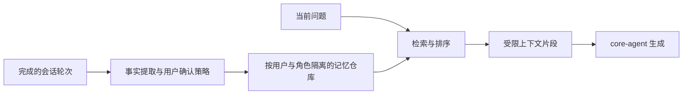

# AIRI 二次开发指南

基准：`2e0e963`。命令中的 pnpm 使用本工作区提供的 11.24.0。

交付、验证和调查报告统一用中文。技术名称、代码、命令、路径和原始错误保留原文，必要时附中文解释。
这是用户的长期要求，优先于上游英文写作规则。说明必须区分真实服务验证、模拟测试和尚未验收的功能。

## 交付前固定回归（AIRI-037）

在工作区运行 `powershell -NoProfile -ExecutionPolicy Bypass -File .\scripts\test-airi-delivery.ps1 -Task AIRI-037`，后续换成当前任务编号。使用已有 Node、pnpm、Python 和 Chromium，不安装新依赖。修改 Vite 宿主或 Python 后，先重启实际进程；进入舞台点击“启动”确认服务就绪，再运行检查。脚本会重建 i18n、语音及视觉共享包，执行全部类型/lint、旧功能联合回归、语音/视觉协议、Python 服务和 Web 构建，最后检查实际 5173 网关。日志和 JSON 结果保存在 `.runtime/delivery/<task>/`。首次失败立即返回非零，不跳过失败、放宽断言或把旧报告当本次结果。

固定基线包含：陌生人及设置入口、人脸身份租期/历史隔离、聊天档案读写/检索、原会话同步、录音与转写、实时语音/音频/任务/取消、持续视觉与问候、关闭/重启/启动中取消、多窗口休眠，以及背景颜色未就绪时的舞台挂载。浏览器文件顺序运行，避免大量 Chromium 同时争夺摄像头、音频和网关测试资源；保持原断言与超时。失败先区分产品错误、测试隔离和服务未配置，不无限重试直到绿灯。

自动通过后，还须操作实际舞台：启动→关闭→再启动，观察模型/设备释放与恢复；休眠时打开右上角设置→机体模块→长期记忆，确认原聊天记录仍可访问。语音变更须复验真实麦克风/扬声器连续通话、插话和停止；身份变更须复验真人进出与换人。缺设备、文字模型或网络条件时，明确记录“待验收”，不能用合成摄像头、短句网关音频或配置存在替代真人效果。故障修复要保留失败复现和修复后测试，并永久纳入固定基线。

启动按钮检查配置和网关可达性，不发送收费的模型完成请求。后台模型显示配置情况并不代表厂商鉴权/模型质量已验收。关闭保持浏览器/设置/本机轻量网关可用，停止通话、采集和生成，并释放本机视觉进程。其他客户端占用时保留共享进程，显示占用；不停止项目管理或远程连接。网页服务本身已停时，仍使用现有 `start-airi.cmd` 或后台启动器恢复。

## 1. 进入开发环境

在 PowerShell 中运行：

```powershell
cd F:\codex\数字生命
. .\scripts\airi-env.ps1
cd airi
pnpm --version
node --version
```

Web 启动快捷入口：工作区根目录的 `start-airi.cmd`。
也可以运行 `powershell -NoProfile -ExecutionPolicy Bypass -File .\scripts\start-airi.ps1`。
终端保持运行。按 Ctrl+C 停止前台服务。

笔记本在家或外出测试时，使用 [笔记本连接指南](08-lan-testing.md)。
当前连接助手通过 LAN 或 UU 的 SSH 隧道提供 `http://127.0.0.1:5173/`。
2026-10-08 主机地址为 `192.168.1.2`，UU 映射目标固定为台式机 `127.0.0.1:22`。
远程恢复缺失服务调用 `scripts/start-airi-background.ps1`，不要等待前台 `start-airi.ps1` 返回。
旧的 `192.168.1.5:5443` 私人链接已因地址变化失效。使用直接 HTTPS 时，须重新核对地址、证书和防火墙。
直接打开家庭 IP 的 HTTP 地址缺少安全上下文。SSH 隧道提供的浏览器回环地址支持设备权限。

## 2. 想改什么，从哪里入手

| 目标 | 优先修改位置 | 联动位置 |
| --- | --- | --- |
| 角色名字、性格、背景与系统提示词 | 先使用角色卡界面，再看 `stage-ui/src/stores/modules/airi-card.ts` | `types/airiCard.ts`、`packages/ccc` |
| 情绪提示与输出标记 | `stage-ui/src/composables/use-airi-runtime-prompt.ts` | `constants/emotions`、`core-agent/src/runtime/llm-marker-parser.ts` |
| 接入一个 OpenAI 兼容服务 | 先使用已有 OpenAI Compatible 配置 | 协议选项、Base URL、模型 ID、浏览器 CORS |
| 新增真正不同的模型服务 | `provider-inference/src/providers/cloud` 或 `local` | `providers/index.ts`、`types.ts`、验证器与 stage-ui 设置界面 |
| 改多轮对话、工具执行、上下文调度 | `core-agent/src/runtime` | `stage-ui/src/stores/chat.ts` 与 `stores/ai/chat-llm` |
| 添加业务上下文或记忆检索结果 | `core-agent/src/runtime/context-registry.ts` 与 context port | `stage-ui/src/stores/chat/context-providers` |
| 保存自定义业务数据 | `stage-ui/src/database/repos` | 数据迁移、导入导出、删除与账号隔离 |
| 替换语音识别 | `stage-ui/src/stores/modules/hearing.ts` | `provider-inference` 和 `libs/providers/providers` |
| 修改豆包实时语音或接入另一种全双工协议 | `packages/realtime-voice/src` | `stores/modules/realtime-voice.ts`、设置页、Stage.vue；见 [实时语音说明](06-realtime-voice.md) |
| 快慢脑、文字入口与后台结果 | `realtime-voice/src/brain.ts`、`stage-ui/src/stores/modules/slow-brain.ts` | `use-chat-input.ts`、实时store、任务面板、brain.test、realtime-brain.browser |
| 联网搜索与真实来源 | `stage-ui/src/tools/web-search.ts`、`stores/modules/web-search.ts` | `tool-resolver.ts`、`WebSearch.vue`、搜索browser测试、慢脑prompt |
| 替换 TTS 或修改播放策略 | `stores/modules/speech.ts`、`packages/pipelines-audio` | `services/speech`、`stores/speech-runtime.ts` |
| 更换 Live2D / VRM 外观 | 先使用模型设置，再看 `components/scenes/Stage.vue` | `stage-ui-live2d`、`stage-ui-three`、`model-driver-*` |
| 新增设置页 | `packages/stage-pages/src/pages/settings` | `stage-layouts` 导航、桌面独立布局、i18n |
| 调整共用 UI 控件 | `packages/ui` | `stage-ui` 业务组合与故事页 |
| 桌面透明窗、托盘、快捷键、屏幕采集 | `apps/stage-tamagotchi/src/main` | `src/preload`、`src/shared`、`src/renderer` |
| 接入外部程序或游戏事件 | `packages/server-sdk` 与 `integrations` | `server-shared` 事件契约、`server-runtime` |
| 做可安装的桌面扩展 | `packages/plugin-sdk` | Manifest v2、Kit API、Electron 扩展宿主 |
| 改认证、云会话、服务端模型网关 | `server/apps/auth`、`server/apps/api` | 后端 schema、迁移、共享协议与 ADR |

表内 `stage-ui` 代表 `packages/stage-ui`。其他缩写对应 [系统架构](01-system-architecture.md) 的目录树。

## 3. 首次配置对话

1. 打开本地 AIRI 页面。
2. 在引导或设置中添加模型服务。
3. 填入服务地址，以及该服务要求的 API Key。
4. 在对话模型设置中选择服务和实际模型 ID。
5. 发送一条文本消息，检查流式输出。
6. 文本对话成功后，再配置语音识别与语音合成。

若使用豆包听说一体，进入“机体 → 实时对话”，填写端到端语音 Key 后返回舞台。可开始语音通话。文字输入需要在意识选择慢脑服务和文字模型，无需麦克风或豆包连接。
主动模式在看到单个有效人物、持有音频宿主且已配置实时语音时，可自动开始一次通话。普通麦克风开关保持开启也能接入，通话期间普通 ASR 暂停。手动挂断后，同一次相遇不自动重连；切回被动再开启主动可重新接入。显示“开始通话”只证明当前没有连接，还需核对摄像头人物、配置、宿主和实际忙碌状态。
语音快脑不要求另外配置文本模型、ASR或TTS。后台思考和文字提问需要在“意识”选择实际模型，慢脑复用已有授权工具与当前会话查询。豆包3.0的文字事件实测只直接朗读，不用它伪装文字问答。
后台模型选择不等于服务可用。任务保留到本轮连接结束，结果按版本进入上下文并等空隙发声；详见[使用与协议](06-realtime-voice.md)。
主动模式按权限向实时通话提供本地视觉文字与已确认人物记忆。
修改网关源码后运行 `pnpm -F @proj-airi/realtime-voice build` 并重启 Web；浏览器端仍支持热更新。

仓库中已有 Ollama 和 LM Studio 适配器。默认地址分别为：

- Ollama：`http://localhost:11434/v1/`
- LM Studio：`http://localhost:1234/v1/`

这些是代码中的默认值，不代表本机已安装或启动对应服务。
远程模型需要有效凭据。本地模型需要另外运行推理服务并加载模型。
不要把个人密钥写入源码或提交到 Git。需要团队密钥时，使用自己的服务端代理。

OpenAI Compatible 默认使用 Chat Completions。只有目标服务支持 Responses 时才切换协议。
Base URL、模型 ID 和服务实际支持的协议必须一致。

## 4. 推荐的首次开发切片

先修改一个角色设定，验证提示词生效。
再新增一个设置项，贯通 i18n、Pinia、持久化与页面展示。
随后再改模型适配、语音或记忆模块。

长期记忆可以按以下边界实现：



此图是开发建议，不是当前已完成的默认功能。
检索结果作为上下文数据进入模型。不要让外部内容自动获得系统指令权限。

## 5. 常用命令

先执行本文第一节的环境初始化。

| 命令 | 用途 |
| --- | --- |
| `pnpm dev` | 上游 Web 开发命令，默认开放网络监听 |
| `pnpm --filter @proj-airi/stage-web exec vite --host 127.0.0.1 --port 5173 --strictPort` | 本部署的 Web 命令 |
| `pnpm dev:tamagotchi` | 桌面开发，首次运行还会准备 Electron |
| `pnpm dev:server` | 启动插件 WebSocket 通道 |
| `pnpm dev:backend` | Docker 启动完整账号后端 |
| `pnpm dev:docs` | 官方文档站 |
| `pnpm dev:ui` | 共享组件故事页 |
| `pnpm build:packages` | 按依赖顺序构建共享包 |
| `pnpm build:web` | 构建 Web 端及依赖 |
| `pnpm -F @proj-airi/stage-web typecheck` | Web 类型检查 |
| `pnpm -F @proj-airi/core-agent typecheck` | 对话核心类型检查 |
| `pnpm -F @proj-airi/core-agent exec vitest run src/runtime` | 对话核心已有测试 |
| `pnpm lint` | 仓库规定的 lint 检查 |
| `pnpm test:run` | 全部测试，含需要浏览器环境的项目 |

上表是操作参考。实际执行结果见 [安装与验证记录](02-installation.md)。
修改共享导出后，按仓库规则执行根级 `pnpm typecheck`。

快慢脑回归从 airi 根目录执行：

```powershell
& $AiriNode $AiriPnpm --filter '@proj-airi/realtime-voice' test:run
$env:PLAYWRIGHT_BROWSERS_PATH = Join-Path $AiriWorkspace '.tools/playwright'
& $AiriNode $AiriPnpm exec vitest run --config packages/stage-ui/vitest.config.ts --project browser src/stores/modules/realtime-brain.browser.test.ts src/stores/modules/realtime-audio.browser.test.ts src/stores/chat/voice-transcript.browser.test.ts
```

使用已有浏览器；没有安装时记录环境限制，不把浏览器启动失败写成功。模拟模型与真实工具轮次只验证工程流程，真实 API 鉴权、延迟和回答质量单独验收。
修改快脑能力时，从慢脑实际工具门控生成投影，配置变化同步活动会话。`context`命令的`slowBrain`与提示描述必须一致，豆包完整session.update重算tools并保留音频配置。至少回归“语音转写→模型派发→慢脑工具轮次→空隙播报→播放确认”和搜索错误/恢复/停用，不用关键词或假结果补齐链路。参见[AIRI-021报告](../airi/docs/ai/reports/2026-10-03-voice-slow-brain-link.md)。

### Firecrawl免费搜索

在“设置 → 网络搜索”选Firecrawl并启用，再点击“测试搜索”。设置独立保存在当前浏览器；另一个浏览器或LAN域名需单独启用。默认关闭不代表服务故障。匿名入口已经实测可用，但不能保证免费账户的每月1,000 credits。仅使用web搜索，遇额度错误停止，未配置账户或付费服务。

官方 `firecrawl-search` 与 `firecrawl-build-search` 已安装到本机Codex skills目录，新会话加载。项目官方CLI 1.25.3位于 `.tools/firecrawl`，没有加入AIRI运行时依赖。先初始化现有环境，再在工作区根目录使用：

```powershell
. ./scripts/airi-env.ps1
firecrawl --version
firecrawl search 'site:firecrawl.dev/pricing Firecrawl free monthly credits' --sources web --limit 3 --no-highlights --json -o .runtime/search-results.json
```

`scripts/firecrawl.ps1`与`.tools/bin/firecrawl.cmd`只接受无凭据免费运行；检测到环境Key、自定义API地址、凭据参数或已保存的CLI凭据会拒绝，防止复用付费账户。不要在任务或文档写入Key。Web运行时同源网关调用同一份官方CLI；填入显式Firecrawl账户Key则使用账户REST，CLI凭据不自动继承。Codex skill与网页应用工具分别接线。匿名反馈仍要求登录，未发送反馈或取得退款。

搜索宿主位于 `packages/stage-ui/src/tools/web-search-gateway.ts`，由stage-web的Vite配置打包加载；修改宿主后核对Web重启与同源端点，不能只依赖页面热更新。它覆盖开发和preview，纯静态部署、Electron和Pocket尚无对应宿主。配置启动失败必须恢复本机Web服务。设置页的注册链接和控制台支持Free账户Key，余额来自官方接口；匿名没有账户月余额。不要根据余额数字推断套餐或自动充值状态，不代替用户注册、接受条款或开通付费。

本轮只改源码和配置，没有新增依赖。若pnpm 11因清单变化尝试自动重装，先核对依赖确实未变，再对本次命令使用 `--config.verify-deps-before-run=false`；不要为绕过提示删除现有node_modules。运行pnpm和脚本前仍需初始化airi-env。

搜索工具和慢脑回归：

```powershell
# airi根目录；先初始化airi-env并设置已有PLAYWRIGHT_BROWSERS_PATH
& $AiriNode $AiriPnpm exec vitest run --config packages/stage-ui/vitest.config.ts --project browser src/tools/web-search.browser.test.ts src/tools/firecrawl-search.browser.test.ts src/stores/modules/web-search.browser.test.ts src/stores/modules/realtime-brain.browser.test.ts
& $AiriNode $AiriPnpm exec vitest run --config packages/stage-ui/vitest.config.ts --project node src/stores/ai/chat-llm/tool-resolver.test.ts src/tools/web-search-gateway.test.ts
```

报告与真实查询证据见[403修复](../airi/docs/ai/reports/2026-10-03-firecrawl-403-fix.md)和[历史接入](../airi/docs/ai/reports/2026-10-03-firecrawl-search.md)。

## 6. 升级与分支

当前源码保留官方 `origin` 与 `main`。本次未向远端提交任何更改。
开始开发时，先创建自己的分支。分支命名规则见 `airi/AGENTS.md`。

```powershell
git status --short
git switch -c yourname/feat/my-companion
```

当前下载为浅层、按需取对象的仓库。它适合开始开发，但没有完整历史。
需要历史时运行 `git fetch --unshallow origin`。
升级前保存本地修改。升级后重新执行冻结锁文件安装，再生成文档索引。

```powershell
pnpm install --frozen-lockfile
cd ..
node scripts/generate-project-index.mjs
```

索引脚本自动更新目录和依赖清单。人工架构说明需要随代码变化复核。
现在可启动 [本地项目管理](05-project-management.md)，自动检测源码及本地工具的改动。
每次开发先建任务，完成后记录修改内容与验证结果；模块职责和数据流变化要同步维护架构文档。

本地访客模式的修改入口：`apps/stage-web/src/App.vue` 控制首次启动，
`packages/stage-layouts/src/components/Layouts/HeaderAvatar.vue` 控制访客导航，
`packages/stage-ui/src/stores/chat/context-providers/user-account.ts` 控制模型请求中的访客称呼。
称呼的中英文案在 `packages/i18n/src/locales/*/base.yaml` 的 `guest` 下；修改后运行 `pnpm --filter @proj-airi/i18n build`。
账号认证状态仍由原有 auth store 管理，不要把访客伪装成已登录账号。

## 7. 许可证与资源

项目代码使用 MIT，见 [LICENSE](../airi/LICENSE)。分发时保留对应许可和版权声明。
Live2D SDK、角色模型、字体、语音模型与第三方服务各有自己的授权条件。
商业化前按实际使用资源核查授权，不能用代码的 MIT 许可替代资源许可。

## 8. 本地视觉开发

正式操作入口是视觉设置页，运行态位于 `stage-ui/src/stores/local-vision.ts`。
舞台按钮切换主动／被动模式。`scripts/start-airi.ps1` 在环境已安装时启动本地视觉服务。
`stage-ui/src/stores/companion.ts` 调度主动思考、问候和语音，`voice-activity.ts` 记录实际说话与转写状态。
自然姓名学习、多人归属、照片与记忆数据库位于 `services/local-vision/social.py` 和 `identity.py`。
姓名候选必须经本人确认才写库。开发者管理权限位于 `services/local-vision/developer.py`，前端门控不替代服务端检查。
跨进程帧协议、Valibot 校验、摄像头锁和隐私策略位于 `packages/local-vision`。
Python 的模型、Pydantic 契约、人脸库与实际测试位于 `services/local-vision`。

```powershell
# 工作区根目录
./scripts/vision.ps1 doctor
./scripts/vision.ps1 test
./scripts/vision.ps1 start
./scripts/vision.ps1 integration

. ./scripts/airi-env.ps1
$env:PLAYWRIGHT_BROWSERS_PATH = Join-Path $AiriWorkspace '.tools/playwright'
Set-Location $AiriRepo
& $AiriNode $AiriPnpm -F '@proj-airi/local-vision' test:run
& $AiriNode $AiriPnpm -F '@proj-airi/stage-ui' exec vitest run --project browser src/stores/companion.browser.test.ts src/stores/local-vision.browser.test.ts src/composables/vision/local-vision-capture.browser.test.ts src/stores/chat/voice-transcript.browser.test.ts
& $AiriNode $AiriPnpm -F '@proj-airi/realtime-voice' test:run
& $AiriNode $AiriPnpm -F '@proj-airi/i18n' build
& $AiriNode $AiriPnpm typecheck
& $AiriNode $AiriPnpm lint
```

修改帧字段时同步维护 TypeScript 与 Python，增加乱序、旧代际、关闭后迟到结果测试。
不要把当前观察写入旧 context registry，也不要将视觉权限加入同步 Pinia 或默认云配置。
新增摄像头消费者须使用共享摄像头锁，并在停止、角色切换和卸载时释放。
改变主动行为时，检查正在说话、停止、失去人物、切换角色以及旧代际结果，不能伪造用户消息触发模型。
自然认识人不要求手工登记。真人样本和真实 API 测试使用用户授权的设备与服务，合成测试不等于质量验收。
完整操作步骤和模型准备命令见 [本地社交视觉](07-local-vision.md)。

### 本机记忆与数据库维护

Web 设置中的“记忆管理”“短期记忆”和“数据库与数据”以及长期记忆内的开发者维护区要求独立的本机开发者登录。长期记忆的聊天档案可直接查看当前人物与智能体的记录；查看其他人物仍需开发者授权。
用户名与密码不写入文档。管理入口仅覆盖 Web/preview 及既有 LAN 网关，Electron/Pocket 尚无对应宿主接口。
修改姓名保留原人物 ID。编辑交流正文必须同时指定人物、角色和事件，删除人物会清理所有所属数据。
数据库修改前使用 SQLite backup 保存私密备份，不把真人档案或截图加入报告和 Git。

若需初始化或轮换账号，使用隐藏密码输入并重启视觉服务：

```powershell
. ./scripts/airi-env.ps1
$DeveloperUser = Read-Host '开发者用户名'
& "$AiriWorkspace/.runtime/vision-venv/Scripts/python.exe" "$AiriRepo/services/local-vision/developer.py" --username $DeveloperUser
./scripts/vision.ps1 stop
./scripts/vision.ps1 start
```

密码摘要配置也属于私密文件。不要通过命令参数或浏览器 localStorage 保存密码。
修改本机网关后重建 `@proj-airi/local-vision` 并重启 Web，修改语言文件后重建 `@proj-airi/i18n`。
仅改变包导出、未改变依赖时，可对本轮命令使用 `--config.verify-deps-before-run=false`，避免 pnpm 自动重装现有依赖。
姓名回归位于 `testsocial.py`、`testdeveloper.py` 和两个管理组件的 browser test，现有视觉测试继续执行。
`vision.ps1 stop` 结束已核对的进程树，包含 Windows venv 启动器的服务子进程。
修改 Python 后重启视觉服务。修改实时语音包后先构建该包，再重启实际占用 5173 端口的项目 Web 服务。
不要用旧日志判断当前服务版本，也不要仅凭模型 ready 判断摄像头正在工作。
经同源网关读取 `/api/local-vision/metrics` 可检查连接、处理帧数、帧年龄和质量拒绝原因。
浏览器回归挂载正式运行组件，使用真实画布视频流和 LV01 通道，仅替换外部推理结果。
Python 连续身份测试使用真实 ByteTrack 与临时数据库，仅替换模型边界和时钟。

轻量人脸模型使用现有 ONNX Runtime，不安装 PyTorch 或执行远程仓库代码。
当前科研项目已准备 EdgeFace XS/S，并选用 EdgeFace S。单次提取与整机节能分开评估。

```powershell
./scripts/vision.ps1 prepare-recognition
./scripts/vision.ps1 recognition-benchmark
./scripts/vision.ps1 recognition-probe
```

`recognition-benchmark` 只在内存读取本机裁剪，并使用开源项目的公开对照图片。
`recognition-probe` 供应人体框和时钟，其余人脸模型、ByteTrack 与数据库是真实实现，不写新照片或记忆。
这两个命令不证明真人摄像头误认率。报告不得包含真实人名、人物 ID 或裁剪图片。
新模型索引必须使用独立模型 hash 和维度，不能将 SFace 与 EdgeFace 向量混入同一矩阵。
私有 `airi/.local/vision/recognition.json` 的 `model` 支持 `sface`、`edgeface-xs`、`edgeface-s`，改变后重启视觉服务。

Web 人脸跟随入口为 `use-face-gaze.ts`，策略在 `local-vision/src/gaze.ts`。
`face_bbox` 必须是当前未镜像画面的归一化位置，无脸时明确为 null。改动时同时更新 Python、契约与传输测试。
Stage 的 `gazePosition` 是镜像后的舞台位置，优先于鼠标。用实际画布边界转换，不能按整个浏览器尺寸推算。
Live2D 通用动作模式复用 SDK 的目光与头部控制。VRM 的 `head-gaze.ts` 先恢复、后叠加，不累计旋转。
测试左右上下移动、静止超过一秒、短暂遮挡、离开、多人和主动／被动切换。
方向、幅度和真实摄像头延迟由笔记本现场确认，浏览器画布流与模型边界替身不能替代它们。

## 8. 跨对话项目知识

新对话先读 [Wiki 首页](../wiki/README.md)，再按问题进入一到两篇专题。
[开发定位](../wiki/overview/change-routing.md) 将需求映射到源码、联动接口和验证入口。
回答算法或数据流问题时附源码依据，区分当前实现、工程验证、现场验收和调研候选。

```powershell
. ./scripts/airi-env.ps1
& $AiriNode ./scripts/project-wiki.mjs find '为什么认识的人会跳名'
& $AiriNode ./scripts/project-wiki.mjs show local-vision
& $AiriNode ./scripts/project-wiki.mjs check
```

开发完成后更新涉及的专题、原架构文档和本轮开发记录。
人工读过变化的源码后，使用 `review <专题id> --task <AIRI编号> --note <核对说明>` 记录证据。
检查命令核对链接和来源变化，不代替业务测试。新增本地工具可运行 `node --test scripts/project-wiki.test.mjs`。
使用已有环境运行 `generate-project-index.mjs`，确认 Wiki 与工作区索引同步。
维护细节和记录模板见 [Wiki 维护流程](../wiki/maintenance.md)。

### 轨迹补采回放

使用已有vision-venv与模型，运行`./scripts/vision.ps1 adaptation-probe`。
Windows临时SQLite测试先将TMP/TEMP指向工作区.runtime。该命令在临时加密图库执行，不写真实人物扩展。
模型合成轨迹验证不能替代真人录像或长期误认验收。UI撤销回归位于memory-manager.browser.test.ts，轨迹回归位于testadaptation.py。


## 快慢脑提示词配置入口

默认规则与schema在realtime-voice/src/prompts.ts，保存接口在stage-ui/stores/modules/brain-prompts.ts。
共享编辑器brain-prompt-editor.vue由实时对话页加载。快脑与慢脑分别消费同一已保存快照。
变更此接口后，核对真实序列化请求与浏览器保存流程，执行共享客户端类型检查并重建i18n。
新增package exports后，现有Vite进程可能仍缓存旧出口。核对监听进程身份后重新加载实际开发服务。
本轮编辑与请求边界验证见[报告](../airi/docs/ai/reports/2026-10-08-brain-prompt-editor.md)。

## 人脸账户定位与回归

确认人物的接线在 `stage-ui/stores/local-vision.ts`，短期身份与本地账户键在 `stage-identity.ts`。
舞台名称在 `stage-layouts/components/Layouts/HeaderAvatar.vue`，历史隔离在 `chat/session-store.ts`。
不要把人物姓名写入 `auth`，也不要用人脸修改云端令牌、额度或开发者会话。
会话切换只移动视觉投影。角色、摄像头或识别策略变化才重启采集。

初始化 `airi-env.ps1` 后，从 `airi` 目录运行：

```powershell
$env:PLAYWRIGHT_BROWSERS_PATH = Join-Path $AiriWorkspace '.tools/playwright'
& $AiriNode ./node_modules/vitest/vitest.mjs run --config packages/stage-ui/vitest.config.ts src/stores/stage-identity.browser.test.ts src/stores/chat/session-store.browser.test.ts src/stores/modules/realtime-brain.browser.test.ts --no-file-parallelism
```

该命令直接使用现有 Vitest，适用于 Windows 的 pnpm exec 未识别命令时。
测试服务只在 Vitest 配置加载，云端连接替换为本机原生 WebSocket，视觉结果采用生成数据。
测试浏览器的 IndexedDB 和视觉场景在用例前清理，不影响舞台服务来源的数据。
核对确认、换人、离开、多人、纠错、撤权、断帧、会话恢复和自动语音接管，再运行根级类型检查与 lint。

### 长期记忆聊天档案的开发与验证

入口为设置 → 长期记忆 → 聊天档案。scenarios/chat-archive.vue 提供本人浏览和整理；services/chat-archive.ts 访问持久原文；stores/chat-archive.ts 负责权限、工具和回顾。修改归属必须同时核对 stage-identity 与会话仓库。其他人物的浏览不能靠前端开关授权，模型工具不跨人物查找。

改动后运行真实浏览器测试，而不是模拟 IndexedDB、Pinia 或 Web Locks。测试只使用生成档案与模拟外部模型接口；导出不能包含内部提示和运行时上下文，删除必须清理关联整理，旧记录缺少时间不得补造。

```powershell
. ../scripts/airi-env.ps1
$env:PLAYWRIGHT_BROWSERS_PATH = Join-Path $AiriWorkspace '.tools/playwright'
& $AiriNode ./node_modules/vitest/vitest.mjs run --config packages/stage-ui/vitest.config.ts chat-archive.browser.test.ts realtime-brain.browser.test.ts session-store.browser.test.ts session-store.test.ts chat.contract.test.ts stage-identity.browser.test.ts tool-resolver.test.ts
& $AiriNode $AiriPnpm --config.verify-deps-before-run=false -F @proj-airi/i18n build
& $AiriNode $AiriPnpm --config.verify-deps-before-run=false typecheck
& $AiriNode $AiriPnpm --config.verify-deps-before-run=false lint
```

命令从 airi/ 执行。界面分页通过不能证明百万消息性能；关键词命中与工具模拟通过不能证明真实模型的回忆准确率。
