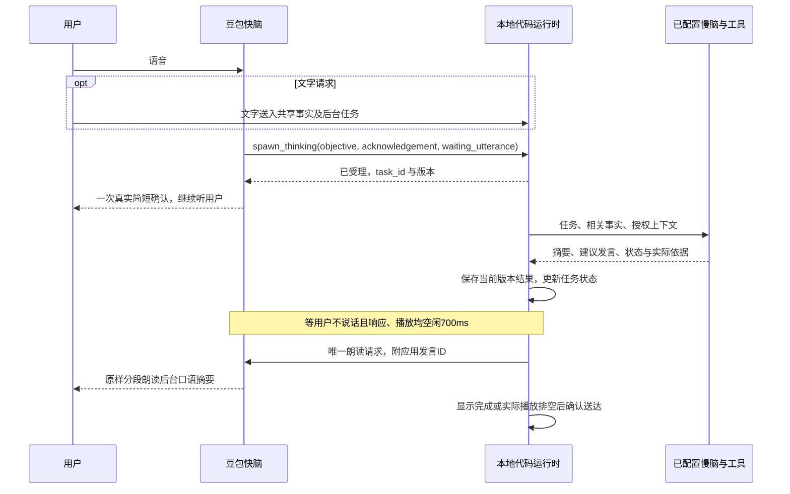

# 豆包实时对话与快慢脑

更新日期：2026-10-04。关联任务：AIRI-016、AIRI-023；真实服务验收继续由 AIRI-004 跟踪。
采用用户提供的快慢脑整理文档与 Qwen Audio Agent 的分工，协议以豆包官方全双工文档及示例为准。

## 使用方法

1. 启动 `start-airi.cmd`，进入 [实时对话设置](http://127.0.0.1:5173/settings/modules/realtime-voice)。无需 AIRI 账号，中文访客仍为“陌生人”。
2. 保存已开通端到端实时语音服务的 Key。现有默认模型 `1.2.6.1`、音色 `zh_female_vv_jupiter_bigtts`、资源 ID `volc.speech.dialog`。不要把营销名称“3.0”当作模型 ID；以账户实际支持的版本为准。
3. 默认启用“聊天框使用后台任务与共享上下文”。在意识模块选择慢脑服务和文字模型后，文字输入进入后台任务，结果显示在聊天记录；不申请麦克风，不连接豆包，也不播放音频。仅保存豆包Key还不能回答文字问题。
4. 要说话，结束文字会话后按“开始通话”，允许麦克风权限。语音通话中也可以输入文字：慢脑处理，应用等待对话空隙让豆包读出，实际播放结束后写入确认上下文。
5. 在 [意识设置](http://127.0.0.1:5173/settings/modules/consciousness) 选择已有模型服务与模型，作为慢脑。快脑会自行判断是否派发任务。首页左上角为悬浮的“快慢脑协作”面板；点击“展开任务”可见版本、进度、摘要、依据、取消和修改按钮，展开不会挤动人物或聊天框。
6. 可以继续闲聊、修改某一任务，或取消它。语音中快脑可派发新版；文字可用“修改任务”提交明确的新版要求，旧结果不再播报。挂断、隐藏、切页、换角色或会话都会取消本轮任务，通话上限十分钟。
7. 实时对话设置新增“会话风格”：默认自然协作；简洁办事减少寒暄；陪伴倾听留出表达空间；基础模式关闭新增表达策略和等待提示。切换同步当前快脑与后续慢脑请求，已派发任务保留派发时策略。当前明确要求优先于风格默认值。

8. 选择“活泼话痨”，再开始语音通话：角色主动分享短内容，不要求你回应，用户插话和正式任务优先。自动续聊需要意识模块的已选慢脑，豆包沿用现有队列读出。单选风格不启动设备；文字模式只改表达风格。首页可“暂停自动说话”或“继续自动说话”，也可在对话中明确要求安静/继续，由模型调用现有控制工具执行。

话痨自动续聊在达到设定的安静时长后准备一段，不以假用户消息触发。默认目标80–180字，验证上限400字符，模型未配置时诚实提示。每通话最多30次准备请求，失败和45秒超时停止自动重试，可手动恢复；达到次数上限后仍能正常对话和执行任务。通话仍限10分钟，模型与语音服务产生实际用量，不保证可以全天运行。换风格/模型、插话、挂断与后台会丢弃旧候选，尚未播放完的内容不进入确认事实。它不新增用户画像或人物卡管理，人物设定仍由当前角色卡负责。验证和边界见[中文报告](../airi/docs/ai/reports/2026-10-04-chatty-conversation.md)。

在“实时对话 → 活泼话痨”设置自动找话题等待时间：默认5秒，可点击5/10秒，也可用滑块选择1–120秒。当前浏览器保存设置，修改后立即重排计时。计时从对话、任务和播放结束后的空闲开始；模型生成与播放另需时间，5秒不是第一声必达时间。
未回应时，模型按当前人物和上下文私下反思措辞、话题匹配及倾听/忙碌等可能性，获得最多两段轻试探机会，随后换话题并展开。用户插话重置机会，只有真正播完的片段推进阶段；沉默不写入情绪或偏好记忆。
面板显示实际等待原因和倒计时。普通摄像头刷新不会取消草稿，权限或相遇范围改变仍会失效。实现与未验收边界见[AIRI-027中文报告](../airi/docs/ai/reports/2026-10-06-chatty-idle-and-reflection.md)。
8. 通话面板的“暂停结果播报”只暂停受理/进度/结果自动发声，后台任务继续；点击“继续结果播报”恢复，也可对快脑明确说暂停或继续。打断结果后自动暂停，避免刚停下就重复回答。已确认播完的分段不重播；中断分段缺少词级对齐，继续时从该分段开头重述。

保存成功只证明本机配置写入，模型已选择只证明本地选择存在；均不证明服务权限、余额、连接和工具已验证。没有慢脑时不向快脑提供派发工具，也不编造后台查询。未选择文字模型时，入口即时提示配置方法并保留草稿，不向历史添加带无效重试按钮的配置错误。图片附件继续走普通图像/文字模型路径。

## 人设与续聊准备检查

快脑、慢脑任务和续聊均读取当前人物卡系统提示。进入“实时对话 → 编辑人物卡与系统提示词”调整身份、语气和习惯，会话风格补充节奏。
工具受理和等待稿由快脑拟定，权威答案由慢脑组织，豆包原样朗读。系统提示无法保证每句遵循；运行时异常仍需真实程序提示。
话痨短稿现为口语文本，单独关闭深度思考，正式任务设置不变。最长等待45秒，失败暂停自动请求。
“自动片段准备3/30次”是请求尝试数，包含中止与失败，不代表失败三次。错误面板现显示HTTP状态或实际类别。
通话前可在话痨设置点击“测试续聊准备”。它只测试当前人物与慢脑，不开语音、不使用聊天历史、不调用工具，会产生一次模型用量。
旧提示未保存具体原因，本轮没有凭空断言那次错误。工程复现与真实服务边界见[中文报告](../airi/docs/ai/reports/2026-10-06-chatty-preparation-and-persona.md)。

## 三部分分工

快脑负责即时对话与语音表达。任务真正受理后，快脑在spawn_thinking参数中按当前人物拟定acknowledgement，应用在真实受理且空闲200ms时朗读一次；同一任务版本不会重复。用户继续说话时优先听用户，任务已迅速完成则直接反馈结果。应用统一安排过渡语和结果朗读，快脑不另生成同一确认或结论，不将准备查询描述为已经核实。
运行时负责有界事实、FIFO 任务、版本、超时、取消和发言机会，不增加“协调大模型”。
慢脑复用意识模块的模型、`core-agent.streamFrom` 和已有授权工具。内置 `read_conversation_records` 只查询当前会话的本地记录。没有新增外部数据库或自动开放桌面操作权限。

自然协作模式下，任务受理约15秒仍未完成时，只有用户不说话、无生成和音频播放，才读一次快脑拟定的等待稿，未提供等待稿时只显示执行进度。每任务版本最多一次，结果已准备好则优先反馈结果；其他风格不主动补等待语。15秒是可调整的工程等待检查，不是通用“冷场”阈值。任务详情中的排队、处理、工具等待/返回/失败来自执行事件，工具返回并不自动表示查询成功。

联网能力须单独启用。进入“设置 → 网络搜索”，选择 Firecrawl 免费搜索并打开开关，点击“测试搜索”检查实际来源、消耗与请求ID。普通聊天和慢脑都使用同一个 `web_search`，由模型实际调用；慢脑把工具证据和建议说法交回快脑。也保留 Tavily，需要另配该服务Key。

首页左上角的“快慢脑协作”面板同时显示慢脑联网状态。启用表示搜索工具已挂载，实际结果以来源为准；未启用或服务错误暂停时有设置入口。AIRI-021修复了快脑未获知慢脑搜索能力、活动通话工具列表不随配置变化的缺口。快脑收到当前能力后，由模型原生函数调用派发查询；没有天气关键词派发规则。开关、错误和恢复会同步进入当前快脑上下文。

Firecrawl留空Key时经本机官方CLI匿名搜索；需要账户月免费额度时，点击设置页“注册或登录Firecrawl免费账户”，选择Free、获取Key并填写，再测试搜索与查询剩余额度。两个入口限额不同，余额以服务端为准，项目不自动升级或充值。权限/额度错误会暂停重复请求；修正配置或再次手动测试后恢复。错误说明的是搜索服务失败，不能直接断言整机不能联网。当前豆包仍发送 `enable_volc_websearch: false`，原生搜索需要独立开通和Key；纯文字不经过豆包。只选择DeepSeek不等于开启搜索。详见[403修复](../airi/docs/ai/reports/2026-10-03-firecrawl-403-fix.md)与[先前联网调查](../airi/docs/ai/reports/2026-10-03-search-capability.md)。

慢脑结果包含 `task_id`、`task_version`、`status`、`result_summary`、`evidence`、`suggested_utterance` 和 `delivery_policy`。
依据取自实际工具执行返回与服务端引用，不采用模型自称的查询来源。`when_idle` 等空隙，`context_only` 只更新状态；`immediate` 也不能抢用户话，只在下个安全空隙投递。任务需要补充信息或失败时同样有结构化结果。

## 共享事实与失效规则

共享的是一份权威会话事实，再分别投影输入。快脑读取近期确认对话、当前任务与有界结果；慢脑获得派发时的相关事实、当前角色、访客身份、上下文及授权视觉文字。私有推理和数据库原始返回不灌进快脑，也不作为普通聊天记录保存。

用户最终转写与已发送文字才进入事实。语音回答需收到音频结束事件且本地播放队列排空；仅生成完成不能证明用户听完。协议没有准确的词级播放对齐，整句被打断时保守排除整句；没有把未听到的尾句当作事实。文字回答显示完成即视为送达。

AIRI-046把实时字幕接入主舞台：进行中的文本先在本地显示，按消息ID更新；音频确认后原文替换同一字幕，打断保留片段标记。显示不提前改变上述确认事实。不同轮次的相同短回答保留为不同记录，VAD与ASR的晚到ID单独关联。

聊天框 Aa 按钮可调正文和气泡大小，默认18px，设置保存在当前浏览器。翻阅旧记录导致暂停跟随时，可点击“回到最新消息”。这些设置不改变音量、模型规则或人物归属。
后台结果始终保存在应用运行时与任务面板。快脑模型只收到待播任务的状态，摘要和建议发言不同时灌入模型生成路径；实际送达或context_only后才投影已确认结果。这样保留共享事实，并由一条语音路径反馈。
任务按 ID 和版本管理。明确改要求或取消才中止指定任务；普通闲聊不取消。超过90秒会失败并释放队列，即便服务不响应 abort，迟到结果也不能回来发言。开始过的外部工具副作用不能由 abort 自动撤销。

当前最多保留8个活动或未送达任务、64条/16,000字符事实。快脑任务投影上限4,500字符，确认对话投影约2,500字符；每次上下文更新有序发送。任务仅存在于当前拥有连接的浏览器，不是跨设备同步或可离线持续运行的作业。
现有会话 action 核对账号、角色、会话与 generation，仍保留删除隔离及视觉派生回复的云同步/历史排除。

## 文件与协议

| 入口 | 责任 |
| --- | --- |
| [brain.ts](../airi/packages/realtime-voice/src/brain.ts) | 事实、任务、版本与结果投递契约 |
| [realtime-voice.ts](../airi/packages/stage-ui/src/stores/modules/realtime-voice.ts) | 会话、播放确认、批量工具回执、空隙投递 |
| [slow-brain.ts](../airi/packages/stage-ui/src/stores/modules/slow-brain.ts) | 真实模型适配与当前会话数据库工具 |
| [use-chat-input.ts](../airi/packages/stage-ui/src/composables/use-chat-input.ts) | 桌面/移动布局文字入口与普通模型路由 |
| [任务面板](../airi/packages/stage-ui/src/components/scenarios/realtime-voice-controls.vue) | 文字/语音模式、状态、来源、取消与修订 |
| [doubao.ts](../airi/packages/realtime-voice/src/doubao.ts) | 官方事件、匹配 call_id、完整 session.update |

实测 `speech_text_buffer.commit` 返回音频、没有文字回答，是直接朗读事件。Qwen将用户文字映射到它，但当前接口不能据此完成文字提问。文字请求因此用已配置慢脑处理。AIRI-023起，慢脑按所选风格生成口语化`result_summary`，文字显示和语音朗读都用该摘要，避免第二版建议话术改掉数字、条件或不确定性。`suggested_utterance`保留预览，不再作为另一路事实稿。摘要至多3000字符，语音按至多400字符原样分段；全部分段实际播完才确认送达。这不替代来源核对，也不证明模型摘要永远正确。
`speak`必须带应用发言ID；真实豆包的`response.output_audio.started`含`tts_type=chat_tts_text`与服务端response_id，网关将其映射到发言ID，分片及匹配的`audio-done`带speechId。真实`response.done`只有usage，不能结束另一段朗读。被取消、重复或旧编号事件不得确认新发言。FC工具移交会结束原生成占用，完成后无需用户再追问。
历史上下文用成对 user/assistant `conversation.item.create`；FC 下行读取 `items`，工具回传同批且保留每个 `call_id`，去重已受理调用。
`session.update` 是完整覆盖，必须保留 model、audio、tools 和顶层 `extension`；整理文档里将 extension 放在 session 内的示例不采用。纯文字模式没有上游语音连接；停止音频输入时协议支持mute，语音后台思考时继续听。关闭先发 `session.close`，等 `session.closed` 或有界超时再关连接。
`context` 命令必须同时携带 `instructions` 和 `slowBrain`，用同一份当前能力更新提示与工具列表。工具配置变化不重建语音连接，不能只替换提示或沿用旧的spawn_thinking。代码已部署后，刷新用户页面并重新开始现有通话，以载入新版契约。
麦克风仍为16kHz PCM16/20ms，输出24kHz单声道 PCM16，沿用口型和静音；原 ASR 在通话期间暂停。慢脑结果复用豆包发声，不走另一套 TTS。
TTS经常比播放速度快，现按约两秒的调度窗口播放，有界缓存最多三分钟，不再把正常十秒以上的回答当异常。打断、静音和挂断清空缓存。格式错误、真实积压上限、未返回音频与朗读超时分别显示具体原因。

## 凭据、部署与验证

Key 保存在 Git 忽略的 `airi/.local/realtime-voice.json`，本地明文，界面只读配置状态，Vite 拒绝 HTTP 读取。删除需用设置页按钮，浏览器数据重置不操作服务端文件。沿用固定上游、同源检查与单会话所有权。
豆包收到音频、文字及有界角色/上下文；已配置慢脑收到任务相关对话、上下文与授权工具返回。费用和权限归实际配置账户，本次沿用已有豆包配置做了短合成文字协议检查，没有创建账号或改动凭据；检查证实朗读可返回音频，未完成真实慢脑与语音工具验收。
本机 Web 开发服务、preview 及现有 LAN 同源代理支持网关。纯静态托管、Electron、Pocket 没有新增宿主网关。
修改网关后构建 `@proj-airi/realtime-voice` 并重启实际5173服务；修改文案后构建 `@proj-airi/i18n`。

[本轮验证报告](../airi/docs/ai/reports/2026-10-02-fast-slow-brain.md) 保存命令与退出状态。自动测试使用模拟上游、真实 WebSocket、Pinia、后台工具轮次、浏览器 DOM 和 AudioWorklet。它们不证明真实豆包鉴权、音色、FC选择、延迟、回声或实际慢脑回答质量。选择可用慢脑后仍需真人验收 A改B、闲聊继续、打断、工具结果和错误处理。文字请求上限2,000字符，超限或未配置保留草稿。

参考：[Qwen 架构](https://qwenaudio.github.io/qwen-audio-agent/architecture/deep-dive)、[官方全双工 API](https://docs.volcengine.com/docs/DoubaoVoice/endtoend-realtime-voice-full-duplex-version?lang=zh)、[接入须知](https://docs.volcengine.com/docs/DoubaoVoice/access-mustread?AuditDocumentID=397063&lang=zh)。

## 主动问候与计时修复（AIRI-028）

活动话痨通话不再跳过首次相遇问候。问候复用慢脑短稿和同一实时语音发声槽位，应用事件为greeting。
普通摄像头周期闲聊让位，避免两个循环。没有慢脑的本地问候能力保留，不冒充模型生成。
问候排空后只存一条实际语音事实，不计入无回应试探预算。
视觉范围变化只取消捕获过上下文的准备/自动播报，不重置未开始的空闲截止时间。
用户开口、任务、暂停和挂断仍控制等待，撤权仍丢弃私人迟到内容。
详细复现与模拟/真实模型验收边界见[中文报告](../airi/docs/ai/reports/2026-10-06-active-greeting-and-recognition.md)。

## 前端修改快慢脑系统提示词（AIRI-033）

设置→实时对话→快慢脑系统提示词，主区域编辑快脑和慢脑工作规则。
展开附加区可编辑慢脑结果、主动问候/续聊、共同规则及当前风格。切换风格可分别修改保存。
默认内容为中文。人物身份继续从人物卡读取，不需要重复创建人设。
先结束语音或文字模式，再保存。下次任务/通话使用保存内容，页面刷新后仍保留。
恢复默认只修改草稿，需要保存。规则存当前浏览器域名，其他设备或域名不自动同步。
系统规则预览包含人物与已注册工具提示，运行时资料在发送时另行加入。
输出JSON与语音校验由程序保留，不能通过提示词新增实际工具权限。
源码接口为useBrainPromptsStore的config/save/reset，详见[专题](../wiki/modules/brain-prompts.md)。

## 2026-10-18：陌生人认识与语音篇幅

当前入口为 http://127.0.0.1:4173/settings/modules/realtime-voice 。在快慢脑系统提示词中编辑“语音篇幅与表达规则”，保存后快脑、语音慢脑结果、问候和续聊共同使用，并沿用原台式机配置同步。默认同时不超过3句、30字，明确要求详细时例外；纯文字不受限。规则是生成引导，不是硬截音频或严格遵从保证。

姓名候选更新后会在空闲时核对一次，明确本人确认后再等待合格样本落库。姓名确认、样本采集和档案保存分别判断；重复问候不清除候选或拒绝。真人效果仍须有摄像头的设备和真实模型验收。

## 2026-10-19：多人在场与并行语音（AIRI-043）

两位陌生人不会按摄像头轨迹反复登录。多人画面撤销私人身份，但不再把持续有人误记成离开，已有自动通话继续保活。真正没有新鲜在场证据超过30秒、切被动或隐藏页面仍按原规则结束自动通话。

后台正式任务与麦克风输入并行。每个工具调用记录来源话轮，迟到的“已受理”只处理原话轮，不再取消用户新问题的语音。受理语和结果仍复用唯一输出队列，等用户及当前回答结束再说。

排查时区分：视觉身份撤销、麦克风停止上传、模型未回答、应用抑制回答和音频播放失败。只看到任务正在执行，不能推断它阻塞了快脑。自动回归使用生成摄像头画面与模拟厂商接口，真实两人入镜、声音辨识和模型选择工具仍需现场验收。详见[本轮报告](../airi/docs/ai/reports/2026-10-19-parallel-voice-and-group-presence.md)。
